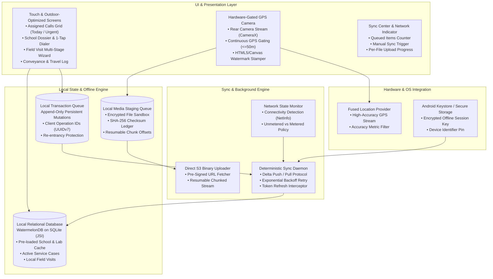
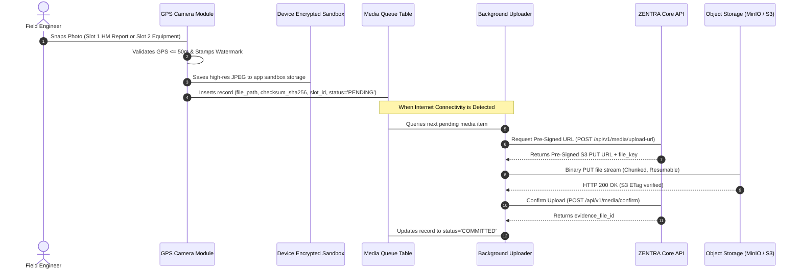

# ZENTRA Field — Mobile Architecture Specification
## Hi-Tech Lab Field Service Management Platform

---

## 1. Mobile-First Principles & Operational Realities

**ZENTRA Field** is the primary operational software application in the ZENTRA ecosystem. It is purpose-built for **Field Engineers** executing technical servicing, diagnosis, component replacement, and evidence capture across thousands of government school **Hi-Tech Labs**.

Field Engineers operate in rigorous physical environments:
- **Remote Rural Geographies**: Many schools in coastal, delta, and forested blocks have zero or intermittent 2G/3G cellular connectivity.
- **Harsh Outdoor Conditions**: High ambient sunlight requires high-contrast typography, large touch targets, and outdoor-optimized UI themes.
- **Resource-Constrained Devices**: Engineers use mid-range Android mobile devices where memory pressure, aggressive OS background task kills, and low battery levels are routine.
- **Uncompromising Proof Standards**: Every physical call closure requires legally and operationally verifiable proof: an HM-signed paper report, a GPS-verified photo of the working equipment, and validated coordinates within the school premises.

To thrive under these conditions, ZENTRA Field is architected as an **Unconditional Local-First System**.

---

## 2. Mobile Architecture Component Stack



---

## 3. Local-First Database & Offline Cache Strategy

### 3.1 Technology Engine: WatermelonDB on SQLite
ZENTRA Field utilizes **WatermelonDB** backed by native SQLite via JavaScript Interface (JSI).
- **Lazy Loading**: Instead of deserializing thousands of school records into JavaScript heap memory, records are loaded lazily on demand.
- **Fast Startup**: App launches in under 1 second on low-end multi-core Android devices.
- **Observable Queries**: React components re-render automatically when local database records update.

### 3.2 Territory Pre-loading & Cache Hierarchy
When an engineer logs in with active connectivity, the mobile client pre-loads a comprehensive **Territory Cache Bundle**:
1. **School Master Directory**: Complete details (UDISE code, school name, category, gate coordinates, HM name, AI instructor name, and phone numbers) for all schools within the engineer's assigned districts.
2. **Active Assigned Calls**: All `service_cases` currently dispatched to the engineer.
3. **Historical School Interventions**: The last 3 service visits executed at each assigned school to provide immediate on-site maintenance history.
4. **Dynamic Equipment Catalog**: Form attribute definitions (`equipment_attribute_definitions`) required to dynamically render diagnostic inspection forms for any hardware type.

---

## 4. The Local Transaction Queue (Zero Data Loss)

All write operations performed on the mobile device (check-in, diagnostic notes, spare parts entered, check-out, conveyance claims) are **strictly prohibited from making direct network calls**.

Instead, mutations follow an append-only **Transaction Queue Pattern**:

```
USER ACTION (e.g. Check-in)
    ↓
1. Write to Local WatermelonDB Entity (Immediate UI response)
    ↓
2. Append to Local Transaction Queue Table (`pending_sync_mutations`)
    ↓
3. Transaction Committed Locally in SQLite (ACID guarantee)
    ↓
4. Background Sync Daemon Notified
```

### Structure of `pending_sync_mutations` Table
| Column Name | Type | Description |
|---|---|---|
| `mutation_id` | UUID | Primary key of the queue item. |
| `client_operation_id` | UUIDv7 | Idempotency key generated by client; embeds monotonic timestamp. |
| `entity_type` | String | Target entity (e.g., `field_visits`, `conveyance_claims`). |
| `entity_id` | UUID | Local ID of the mutated record. |
| `operation_type` | Enum | `INSERT`, `UPDATE`, `SOFT_DELETE`. |
| `payload_json` | Text (JSON) | Exact delta fields to commit on server. |
| `sync_status` | Enum | `QUEUED`, `IN_FLIGHT`, `ACKNOWLEDGED`, `FAILED_RETRY`. |
| `retry_count` | Integer | Incremented upon transient network failure. |
| `last_error_message` | Text | Captured error details for diagnostics. |
| `created_at` | Timestamp | Timestamp when the user performed the action. |

---

## 5. Media Staging & Direct Binary Upload Queue

A critical lesson from legacy system failures was the breakdown of file uploads when encoding 1.4MB–5MB photos into base64 JSON API payloads. ZENTRA Field enforces a **dedicated media queue**:



### Media Architectural Rules
1. **Never in JSON**: Photos are never transmitted in JSON request bodies.
2. **Direct to Object Storage**: Media streams directly from mobile sandbox storage to S3-compatible object storage via pre-signed URLs, bypassing application web servers.
3. **SHA-256 Checksum Verification**: Before uploading, the client computes the file's SHA-256 hash. The server validates that the object stored matches this exact checksum.
4. **Independent Slot Processing**: Slot 1 (HM Report) and Slot 2 (Equipment Photo) are enqueued as separate records. If Slot 1 succeeds while Slot 2 fails due to network loss, Slot 1 remains permanently committed while Slot 2 retries independently.

---

## 6. Hardware Integration: GPS Camera & Accuracy Gating

Physical call completion requires indisputable proof that the engineer was physically inside the school laboratory.

### Hardware GPS Gating Logic
1. **Continuous Location Stream**: When the engineer opens the Camera Viewfinder, the native Fused Location Provider activates with `PRIORITY_HIGH_ACCURACY`.
2. **Strict Accuracy Filter**:
   - The camera shutter button is **strictly disabled** while GPS accuracy is greater than 50 meters (`accuracy > 50.0m`).
   - A visual HUD indicates current accuracy (e.g., "Acquiring GPS: Accuracy 85m... please move near window", transitioning to "GPS Locked: Accuracy 12m [Ready]").
3. **Visible & Permanent Watermarking**:
   - Before writing the JPEG to disk, an immutable visual watermark is burned into the lower pixel banner of the image.
   - Watermark content: `[School Name] | [UDISE Code] | [Lat, Lng] | [Accuracy: 14m] | [UTC Timestamp] | [Case Code] | [Engineer Name]`.
4. **Server-Side EXIF Metadata**:
   - Authentic GPS IFD tags (`0x8825`) are injected into the file EXIF header for automated server-side verification.

---

## 7. Authentication State & Offline Session Security

Field Engineers cannot be blocked from working simply because their JWT token expired while traveling in a zero-connectivity area.

### Offline Session Architecture
- **Dual-Token Model with Offline Grace Period**:
  - `access_token` (Short-lived, 15 minutes, used for active API calls).
  - `refresh_token` (Long-lived, 30 days, stored in Android Keystore).
  - `offline_work_permit` (Cryptographically signed payload specifying: `user_id`, `assigned_districts`, `permit_expiry_timestamp` up to 14 days).
- **Offline Permission Enforcement**:
  - The local SQLite engine validates that mutations belong to cases in the engineer's assigned territory.
  - As long as the `offline_work_permit` has not expired, the engineer can perform all operational tasks (check-in, diagnosis, photo capture, check-out) offline.
- **Reconnection Token Refresh**:
  - As soon as the network monitor detects internet connectivity, the sync daemon silently calls `/api/v1/auth/refresh` before draining the transaction queue.
  - If the user was suspended or deactivated by an administrator while offline, the refresh call fails, the transaction queue is frozen, and an alert is displayed.

---

## 8. Failure & Recovery Scenarios

The mobile client is engineered to recover gracefully from all common operating system disruptions:

### 8.1 Scenario: Application Crash or OS Memory Kill
- **Failure**: The Android OS kills ZENTRA Field in the background while the engineer is typing on-site diagnostic notes or while a photo is uploading.
- **Recovery**:
  - All form inputs are auto-saved to WatermelonDB drafts on every keystroke.
  - The transaction queue is stored on disk in SQLite; pending items remain intact.
  - Upon relaunch, the app detects an incomplete visit, restores the exact form state, and resumes the sync daemon.

### 8.2 Scenario: Device Battery Dies Mid-Visit
- **Failure**: The phone battery drains completely after check-in but before check-out.
- **Recovery**:
  - The check-in timestamp and GPS coordinates were already committed to the local database at the moment of check-in.
  - When the phone is recharged and powered on, the active visit displays a persistent "Visit in Progress" banner with elapsed time.

### 8.3 Scenario: Network Drops During Media Upload
- **Failure**: A 3MB photo is 60% uploaded to object storage when the engineer enters a dead zone.
- **Recovery**:
  - The media uploader utilizes S3 multipart resumable uploads.
  - The chunk offset is stored in the local media queue.
  - When connectivity returns, the upload resumes from the last confirmed byte chunk without re-uploading the entire file.

### 8.4 Scenario: Device Restarted by User
- **Failure**: The user restarts their phone.
- **Recovery**:
  - An Android `BOOT_COMPLETED` broadcast receiver registers the ZENTRA sync worker.
  - The background daemon evaluates network availability and resumes queue draining without requiring the engineer to manually open the app.

---

## 9. Summary of Mobile Architectural Guarantees

1. **Zero Data Loss**: Any action committed to the mobile screen is written to disk before the user moves to the next screen.
2. **Deterministic Sync**: Network calls are queued and retried with exponential backoff; no user intervention required.
3. **Hardware-Enforced Integrity**: Photos are captured directly through native camera hardware with GPS accuracy thresholds enforced in code.
4. **Outdoor Usability**: Complete functional independence from active network connections.
