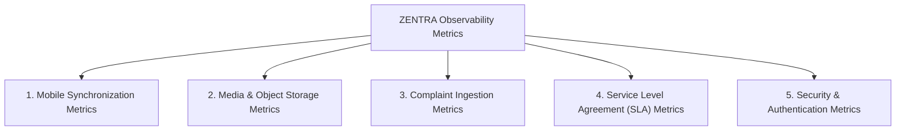

# ZENTRA — Observability, Logging & Metrics Strategy
## Hi-Tech Lab Field Service Management Platform

---

## 1. Architectural Purpose & Observability Mandate

ZENTRA operates across thousands of geographically dispersed schools with thousands of daily asynchronous mobile sync transactions, binary photo uploads, and staged spreadsheet imports.

Traditional flat-text console logs fail in distributed, offline-first architectures. ZENTRA enforces an **End-to-End Structured Observability Architecture**:
1. **Correlation Tracing**: Every transaction carries an immutable `correlation_id` across client, gateway, backend service, and database queries.
2. **Strict PII Redaction**: Headmaster and AI Instructor personal phone numbers, passwords, and tokens are scrubbed before log serialization.
3. **Domain-Specific Telemetry**: Metrics track field sync health, upload success rates, SLA breach velocity, and duplicate classification trends.

---

## 2. Structured JSON Logging Standards

All application logs (backend and mobile sync daemons) output structured JSON adhering to the **Pino / OpenTelemetry Standard**:

```json
{
  "timestamp": "2026-10-05T08:45:12.304Z",
  "level": "INFO",
  "service": "zentra-core",
  "environment": "production",
  "correlation_id": "01925b42-8e10-7341-b2c9-9430c49a1020",
  "request_id": "req-98412",
  "user_id": "usr-fe-shameer-569",
  "device_id": "android-build-73fc69f8",
  "district_code": "NGP",
  "service_case_id": "01925b42-8e15-7e66-94bb-abcdef123456",
  "client_operation_id": "01925b42-8e16-7f77-85cc-fedcba654321",
  "action": "SYNC_PUSH_COMMITTED",
  "message": "Field visit check-in successfully committed for school UDISE 33190400501",
  "duration_ms": 42.6,
  "context": {
    "sync_batch_size": 3,
    "gps_accuracy_meters": 14.2,
    "visit_outcome": "RESOLVED_ON_SITE"
  }
}
```

### 2.1 The 5 Standard Log Levels
- **`DEBUG`**: Fine-grained diagnostic information for development and staging (e.g., SQL query execution times, sync delta packet counts). Disabled in production.
- **`INFO`**: High-level operational events (e.g., successful user login, visit checked in, staged import approved, pre-signed upload URL issued).
- **`WARN`**: Recoverable operational anomalies (e.g., clock skew detected and adjusted, rate limit threshold reached, duplicate complaint staged as Chaser, transient S3 upload retry).
- **`ERROR`**: Non-fatal operational failures requiring attention (e.g., database transaction rollback, token signature verification failure, malformed spreadsheet parse error).
- **`FATAL`**: Unrecoverable system errors terminating the process (e.g., PostgreSQL connection pool failure at startup, unhandled exception in background worker, fail-closed test gate triggered).

---

## 3. Strict Personally Identifiable Information (PII) Redaction

In legacy systems, contact spreadsheets containing thousands of teacher personal mobile numbers were dumped into console logs and tool outputs.

### Redaction Rules
1. **Phone Number Masking**: Mobile phone numbers must never be logged in raw form. All logging middleware applies regex scrubbing:
   - Raw: `9894317355` $\rightarrow$ Masked: `989****355`.
2. **Zero Credential Logging**: Authorization headers, passwords, refresh tokens, and session secrets are scrubbed at the logging interceptor.
3. **No Raw Image Payloads**: Base64 strings or binary buffer streams are strictly blocked from log output.

---

## 4. Authoritative System Metrics Catalog

ZENTRA Core exposes standardized Prometheus metrics (`/metrics`) across 5 operational dimensions:



### 4.1 Mobile Synchronization Metrics
- `zentra_sync_push_total{status="success|conflict|failed"}`: Counter of mobile mutation sync pushes.
- `zentra_sync_pull_duration_seconds`: Histogram of delta query execution times.
- `zentra_sync_conflicts_total{domain="admin|source|field"}`: Counter of detected domain conflicts.
- `zentra_active_offline_queue_gauge{user_id="..."}`: Gauge of pending client mutations.

### 4.2 Media & Object Storage Metrics
- `zentra_media_upload_requested_total{slot="slot_1|slot_2|aux"}`: Count of pre-signed URLs generated.
- `zentra_media_upload_confirmed_total{slot="..."}`: Count of verified binary uploads.
- `zentra_media_upload_duration_seconds`: Time taken between pre-signed URL issuance and client confirmation.
- `zentra_media_checksum_mismatch_total`: Alerting metric for corrupted uploads.

### 4.3 Staged Ingestion Metrics
- `zentra_import_jobs_total{status="staged|approved|aborted"}`: Counter of bulk complaint spreadsheets.
- `zentra_import_rows_parsed_total`: Total complaint rows extracted.
- `zentra_import_duplicates_detected_total{tier="1|2|3|4|5"}`: Distribution of duplicate classifications.

### 4.4 SLA Governance Metrics
- `zentra_cases_active_gauge{priority="critical|high|medium|low", district="..."}`: Active ticket inventory.
- `zentra_sla_breach_warning_total{priority="..."}`: Tickets reaching 75% elapsed SLA window.
- `zentra_sla_breached_total{priority="..."}`: Tickets exceeding 100% SLA duration.
- `zentra_mean_time_to_resolve_hours{district="..."}`: Rolling 30-day MTTR.

### 4.5 Security & Authentication Metrics
- `zentra_auth_login_attempts_total{status="success|failed"}`: Login velocity and brute-force detection.
- `zentra_rate_limit_exceeded_total{endpoint="..."}`: Throttled client requests.
- `zentra_clock_skew_flagged_total`: Mobile check-ins flagged with suspected clock tampering.

---

## 5. Health Check & Probing Architecture

To support automated container orchestrators (Kubernetes / Docker Swarm) and load balancers:

| Probe Endpoint | Evaluation Scope | Expected Response | Failure Action |
|---|---|---|---|
| **`/api/v1/health/liveness`** | Fastify process event loop responsiveness | `{"status": "ok", "uptime_s": 842}` (HTTP 200) | Container restarted if non-responsive. |
| **`/api/v1/health/readiness`** | PostgreSQL pool connection + MinIO S3 bucket access | `{"status": "ready", "db": true, "storage": true}` (HTTP 200) | Removed from load balancer traffic. |

---

## 6. Summary of Observability Architecture Specifications

1. **End-to-End Traceability**: Every field action correlates directly from mobile SQLite mutations to database audit records.
2. **Data Privacy Protection**: Contact numbers and credentials permanently masked from log streams.
3. **Proactive SLA Monitoring**: Real-time alerting on tickets approaching contractual breach thresholds.
4. **Zero Client Logging Overhead**: Mobile app logs locally to rolling ring buffer; uploads only on explicit diagnostics request.
