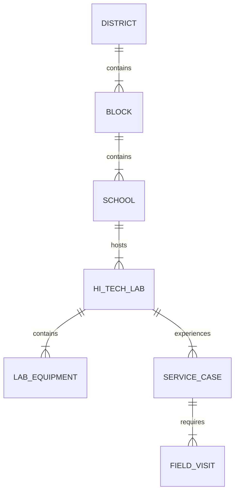
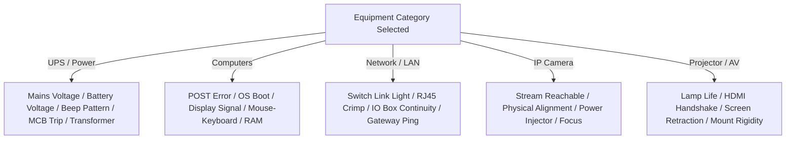
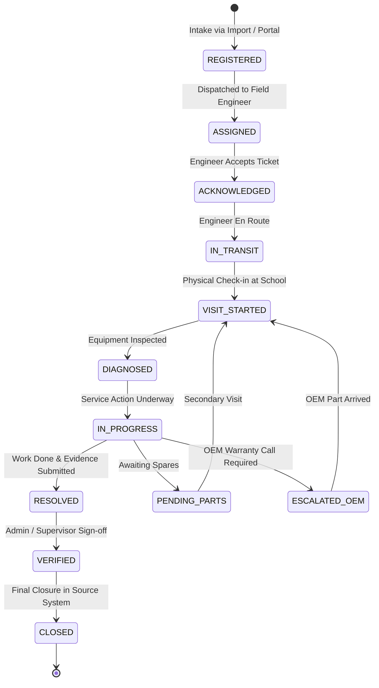

# ZENTRA
# Hi-Tech Lab Field Service Management Platform

---

## 1. Project Purpose

**ZENTRA — Hi-Tech Lab Field Service Management Platform** is a specialized, enterprise-grade field service management and ticketing ecosystem designed to maintain, service, repair, and audit Information & Communication Technology (ICT) infrastructure across government school **Hi-Tech Labs**.

In government schools across Tamil Nadu (and scalable to other states), Hi-Tech Labs have been established to provide digital literacy, computer education, and online assessment capabilities to students. Each lab consists of critical computing systems, networking hardware, power backup infrastructure, surveillance, and interactive display technology. When equipment malfunctions, academic schedules and state-wide digital assessments are interrupted.

ZENTRA provides an end-to-end operational platform that bridges the gap between:
1. School-level complaint reporting (originating from Headmasters, Lab Instructors, Central Helpdesks, and State Portals).
2. Administrative oversight and dispatch by State/District Reporting Heads.
3. Field execution, equipment diagnosis, spares utilization, evidence capture, and physical resolution by Field Engineers on the ground.

### Strict Architectural Independence
ZENTRA is a completely **NEW**, ground-up product. It is **NOT** a refactor, migration, or rewrite of the legacy "Field Call Tracker" or "Ai Ticket App". The historical applications are referenced exclusively for domain knowledge, business workflows, operational patterns, and security forensics. ZENTRA maintains complete independence:
- Independent codebase (mobile app, web app, backend services).
- Independent database and persistence engine.
- Independent authentication, authorization, and tenant isolation mechanisms.
- Independent media/evidence object storage.
- Zero connection to legacy Google Sheets, Google Apps Script webhooks, legacy production databases, or legacy Worker processes.

---

## 2. Product Vision

The vision of ZENTRA is to transform fragmented, reactive school ICT maintenance into a structured, auditable, and configuration-driven field engineering lifecycle.

### Core Tenets of ZENTRA
- **Zero Academic Downtime**: Enable rapid dispatch and first-time-fix resolution of Hi-Tech Lab equipment failures.
- **Dual-Surface Platform**:
  - **ZENTRA Field**: High-performance, mobile-first operational application for Field Engineers operating outdoors under constrained network conditions.
  - **ZENTRA Web**: Comprehensive management, governance, dispatch, SLA monitoring, and reporting portal for Administrators, District Coordinators, and Reporting Heads.
- **Multi-Equipment Agnostic Architecture**: Support every equipment class present in a Hi-Tech Lab (Computers, Routers, Switches, I/O Cabling, UPS/Power, IP Cameras, Webcams, Projectors, Smartboards, and Electricals) through flexible, extensible schemas.
- **Verifiable Field Evidence**: Ensure that every physical repair is indisputably proven through multi-stage photographic evidence, GPS location verification, and school authority sign-offs.
- **Fail-Safe Operational Integrity**: Eliminate past architectural failure classes such as whole-dataset overwrites, test/live data contamination, ghost uploads, and data resurrection.

---

## 3. Mobile-First Strategy

The primary operational actor in the ZENTRA ecosystem is the **Field Engineer**. Field Engineers do not operate behind desks; they travel between remote and rural government schools by motorcycle or public transit, carrying toolkits, spare parts, and diagnostic instruments.

Consequently, ZENTRA is designed with a **Mobile-First Strategy**:
- **Field-First Usability**: The mobile client, **ZENTRA Field**, is the primary touchpoint for data creation, inspection, and case resolution.
- **Outdoor Ergonomics**: High-contrast user interface elements, large touch targets, minimal typing, barcode/QR scanning affordances, and structured multi-stage wizards tailored for outdoor sunlight and one-handed operation.
- **Offline Resiliency**: Unconditional local-first capability. Field Engineers must be able to view assigned tickets, access school contact directories, log visit details, record spare parts, and capture camera evidence without active cellular connectivity.
- **Deterministic Synchronization**: Seamless local queuing with explicit sync states, automatic retries with exponential backoff upon network restoration, and zero data loss on application restart.

---

## 4. User Types

Based on operational analysis of field workflows, ZENTRA identifies the following distinct user roles:

| Role | Primary Interface | Operational Scope & Responsibilities |
|---|---|---|
| **Master Admin (System Superuser)** | ZENTRA Web | Global platform configuration, user provisioning, role-based access control, audit log inspection, master data management, system security, and integration oversight. |
| **Reporting Head / State Operations Lead** | ZENTRA Web | State-wide / region-wide visibility, SLA breach monitoring, executive dashboards, bulk complaint dispatch, contractor/vendor SLA verification, and aggregate conveyance/inventory approval. |
| **District Manager / Coordinator** | ZENTRA Web | District-level operational supervision, reviewing incoming complaints, assigning complaints to Field Engineers, monitoring open ticket age, reassigning tickets, and verifying field visit evidence. |
| **Field Engineer (Primary Operational User)** | ZENTRA Field (Mobile) | Receiving assigned tickets, contacting school authorities, physical site visits, equipment diagnosis, hardware servicing, spares consumption recording, capturing GPS-tagged photographic evidence, obtaining physical HM sign-offs, and logging conveyance claims. |
| **School Authority: AI (Administrator cum Instructor)** | School Contact / Submitter | In-charge computer teacher for the Hi-Tech Lab. Registers complaints, demonstrates hardware symptoms to engineers, provides lab access, and verifies operational readiness post-service. |
| **School Authority: HM (Headmaster / Headmistress)** | School Sign-off Authority | Institutional head. Validates engineer presence, approves physical lab intervention, and signs the physical Field Service Completion Report. |
| **OEM / Spares Vendor Coordinator** *(Potential)* | ZENTRA Web (Restricted) | External hardware warranty provider (e.g., UPS manufacturer, monitor vendor) tracking escalated warranty calls, replacement part dispatch, and RMA handovers. *(Requires Clarification)* |

---

## 5. Complaint Data Understanding

Empirical analysis of registered complaint records across Tamil Nadu Hi-Tech Labs (`HiTech Labs Live _ Down Assets_data (1).xlsx`, `Field_Call_Tracker.xlsx`, `Thiruvarur_HTL_Service_Desk_Master.csv`, `Thiruvarur_22_Schools_UPS_Complaint_Tracker.csv`, and `htl_itsm_tickets.json`) demonstrates the real-world operational landscape:

### 1. Scale & Distribution
- **8,209+ Hi-Tech Labs** operate across **38 Districts** in Tamil Nadu.
- Each school is identified nationally by a unique **11-digit UDISE Code** (Unified District Information System for Education, e.g., `33190400501`, `33200305301`).
- Individual schools may host one or more Hi-Tech Labs, identified by a composite Lab ID (e.g., `33320100101_HL01`, indicating UDISE `33320100101` and Lab `HL01`).

### 2. Multi-Channel Intake Sources
Complaints originate through diverse channels before reaching field engineers:
1. **Centralized Helpline Calls (`HELPLINE TICKET`)**: Inbound telephone calls from school staff to a central education department call center.
2. **Ticketing Tool Escalations (`TICKETING TOOL TICKET` / `Ticketing Tool`)**: Electronic tickets registered via state IT / educational service desks (frequently identified by integer IDs such as `12511`, `11733`).
3. **Google Form / Web Intake (`GOOGLE FORM - AI`)**: Structured forms filled directly by school Lab Instructors (AI Teachers).
4. **Internal Vendor / Field Observations (`KS SMART`)**: Issues identified during routine maintenance drives or pre-installation audits.
5. **Direct Teacher Service Desk Submissions**: Forms with attached initial symptom photographs.

### 3. Data Represented in Real Records
Each record represents a physical or operational failure within a school's digital classroom infrastructure. Crucially, the records contain:
- Where the problem is (District, Block, School Name, UDISE, Lab ID).
- Who reported it and whom to contact (AI Instructor Name, Mobile Number, HM Name).
- What the reported symptom is (e.g., "SYSTEM 5,8 N/W NOT CONNECTED", "I/O BOX DAMAGED", "Total Dead / No Power / Lab Off", "IP Camera positioned downward").
- How long the failure has persisted (Logged Date, Issue Duration, Ticket Age in days).
- What priority was assigned at intake (Critical, High, Medium, Low).
- Escalation metadata (Vendor Name, Vendor Ticket Number, Target Plan-of-Action Date).

---

## 6. Source Complaint Information

A foundational requirement for ZENTRA is the **strict architectural separation** between the complaint as originally received from external systems and the ongoing service activity executed by field engineers.

**Source Complaint Information** represents the static, historical snapshot of what was reported by the complainant or external platform. This data must be preserved immutably:

| Field Name | Type | Description / Real-World Evidence |
|---|---|---|
| `source_system` | Text / Enum | Intake origin: `HELPLINE`, `EXTERNAL_ITSM_TOOL`, `TEACHER_PORTAL`, `VENDOR_DRIVE`. |
| `external_ticket_id` | Text | Original ticket number from the source system (e.g., `12511`, `12434`, `TKT-2026-981`). |
| `original_title` | Text | Short summary provided by source intake. |
| `original_description` | Text | Raw problem description submitted by the complainant. |
| `registered_date` | Timestamp | Timestamp when the ticket was created in the source system. |
| `source_status` | Text | Status reported by the source system (e.g., `New / Under Review`, `Open`, `Pending Verification`). |
| `source_priority` | Text / Enum | Initial priority assigned at source (`Critical`, `High`, `Medium`, `Low`). |
| `source_sla_target` | Timestamp / Text | SLA resolution target or "Target POA Date" provided by external authority. |
| `reported_equipment_type` | Text | Equipment category indicated at intake (e.g., "UPS", "LAN", "Computer"). |
| `reported_serial_number` | Text | Serial number provided by teacher/intake (frequently blank or approximate). |
| `intake_photos` | Array of URLs | Up to 4 symptom photos captured at intake (e.g., Front Panel, Overall Lab, Battery/MCB, Isolation Transformer). |
| `reporter_name` | Text | Name of the person logging the complaint (AI Instructor or HM). |
| `reporter_phone` | Text | Contact mobile number of the reporter. |
| `original_remarks` | Text | Notes appended during external intake. |

> [!IMPORTANT]
> **Source Complaint Data is Immutable**: Field Engineers and System Admins must never overwrite original intake descriptions or timestamps. Any correction, refinement, or diagnostic update belongs exclusively to Field-Service Information.

---

## 7. Field Service Information

**Field Service Information** represents the dynamic, ground-truth record of operational actions executed by ZENTRA personnel to investigate and resolve the issue.

| Field Name | Type | Description / Operational Role |
|---|---|---|
| `zentra_case_id` | Text (Unique) | ZENTRA's internal canonical service case identifier. |
| `assigned_engineer_id` | UUID / Ref | Unique identifier of the dispatched Field Engineer. |
| `assignment_timestamp` | Timestamp | Date and time when the engineer was assigned. |
| `service_status` | Enum | Internal operational state (`ASSIGNED`, `IN_TRANSIT`, `VISIT_IN_PROGRESS`, `PENDING_SPARES`, `PENDING_VENDOR`, `RESOLVED`, `CLOSED`). |
| `actual_equipment_type` | Text | Hardware category confirmed by the engineer on-site (may differ from reported type). |
| `actual_oem` | Text | Verified manufacturer (e.g., APC, Emerson, Delta, D-Link, Cisco, Acer, HP). |
| `actual_model` | Text | Verified hardware model. |
| `actual_serial_number` | Text | Physically verified equipment serial number read from asset badge. |
| `actual_condition` | Enum | Physical state: `FUNCTIONAL`, `DAMAGED`, `BURNED`, `MISSING`, `WARRANTY_EXPIRED`. |
| `engineer_diagnosis` | Text | Detailed root cause analysis after physical bench/meter testing. |
| `action_taken` | Text | Exact servicing performed (e.g., "Crimped RJ45 at Switch Port 6", "Replaced battery terminal link"). |
| `spares_consumed` | Array of Objects | Inventory items used (`item_name`, `quantity`, `serial_or_batch`). |
| `evidence_photos` | Array of Objects | Mandatory field photographs captured on-site with tamper-proof metadata. |
| `hm_signoff_photo` | URL / Object | Photo of the physical service report signed and stamped by the Headmaster. |
| `equipment_completion_photo`| URL / Object | Photo of the serviced equipment operating normally, with verified GPS watermark. |
| `pending_reason` | Enum / Text | If incomplete: `AWAITING_PARTS`, `OEM_ESCALATION`, `POWER_OUTAGE_AT_SCHOOL`, `LAB_LOCKED`. |
| `follow_up_date` | Date | Scheduled target date for secondary visit. |
| `conveyance_log` | Object | Travel claim (`starting_km`, `ending_km`, `mode_of_transport`, `expense_incurred`). |
| `resolution_timestamp` | Timestamp | Date and time when service was physically validated and completed. |

> [!CAUTION]
> **Source Status ≠ Field Service Status**:
> Under no circumstances may `source_status` and `service_status` be merged into a single field. A ticket may be `Pending` in the government helpline while simultaneously `VISIT_IN_PROGRESS` or `RESOLVED` in ZENTRA. Conflating them destroys operational visibility and causes synchronization races.

---

## 8. School and Lab Information

Master data regarding educational institutions is relatively stable, while complaints and service visits are dynamic transactions. The data taxonomy must cleanly delineate these spheres:



### Taxonomy Classification
1. **Master Data (Reference Entities)**:
   - **District**: District Name (e.g., `Nagapattinam`, `Thiruvarur`, `Ariyallur`), District Code, Educational District.
   - **Block**: Block Name (e.g., `Keezhaiyur`, `Vedaranyam`, `Koradachery`, `Nannilam`).
   - **School**: School Name (e.g., `PUMS VILUNTHAMAVADI WEST`, `GGHSS KORADACHERY`), 11-Digit UDISE Code (`33190400501`), Category (`PUMS`, `GHSS`, `GGHSS`, `GHS`), Base Postal Pincode (e.g., `609703`, `611001 Zone`).
   - **Hi-Tech Lab**: Lab Code/ID (`33320100101_HL01`), Lab Type (`Primary`, `Upper Primary`, `Secondary`, `Higher Secondary`), Room Location.
   - **School Contacts**: Headmaster (HM) Name & Contact Phone; Lab Instructor (AI) Name, Contact Phone, Employee ID (e.g., `_5947`).
   - **Lab Equipment Base**: Pre-provisioned asset register per lab (baseline counts: 10/20 Desktops, 1 UPS, 1 Router, 1 Switch, 1 IP Camera, 1 Web Camera, 1 Projector).

2. **Complaint Data (Transactional Source)**:
   - The specific incident ticket linking an external report to a specific school and equipment symptom on a specific date.

3. **Field-Service Data (Operational Transaction)**:
   - Engineer dispatch record, GPS-tagged visits, on-site measurements, replacement spares, and physical sign-offs.

---

## 9. Equipment Information

Analysis of real complaints proves that ZENTRA **must not be designed as a single-equipment or UPS-only platform**. A wide array of distinct ICT equipment types appears across the 8,209 school labs.

### Equipment Categories Grounded in Project Data
The following equipment classes are directly evidenced in the supplied dataset:

1. **Computers / Computing Hardware**:
   - Monitored as "Live Computers" in central asset tracker.
   - Real complaint issues: "SYSTEM 5,8 N/W NOT CONNECTED", "Two CPU not working", "Cpu and monitor current not supply", "1 SYSTEM I/O PORT ISSUE".
   - Attributes required: Hostname/System Number (e.g., System 1 to 20), CPU Model, RAM, Storage, OS Status, Peripherals (Keyboard, Mouse, Monitor).
2. **Network Switches**:
   - Evidence: "D-Link 8PORT SWITCH", "D-Link to system lan cable not connected", "Cable grimped again at switch end".
   - Attributes: OEM (e.g., D-Link), Port Count (8-Port, 16-Port, 24-Port), Managed/Unmanaged, PoE Status.
3. **Routers & WAN Gateway**:
   - Evidence: "MERAKI ROUTER", "UNABLE TO CONNECT INTERNET", "Router Live/Down".
   - Attributes: OEM (e.g., Cisco Meraki), SIM / Broadband WAN connection, Gateway IP, Status.
4. **Structured Cabling & I/O Ports**:
   - Evidence: "I/O BOX DAMAGED", "IO BOX PROBLEM", "CPU to input output internet port not working", "patch cord not Attached", "Rj45 Jack".
   - Attributes: Port Number, Wall Box Location, Cable run type (Cat6), Punch-down block.
5. **Uninterruptible Power Supply (UPS) & Inverters**:
   - Evidence: "Total Dead / No Power", "Continuous Beep Sound", "Isolation Transformer / MCB Tripping", "No Battery Backup".
   - Attributes: KVA Rating (e.g., 3KVA, 5KVA), Battery Bank Voltage, Battery Count (e.g., 8x 12V 42Ah), Isolation Transformer status, MCB rating.
6. **IP Surveillance Cameras**:
   - Evidence: "IP-Camera Live/Down", "DUE TO THE IP CAMERA BEING POSITIONED DOWNWARD, THE CLASSROOM IS NOT VISIBLE. ONLY THE FLOOR TILES CAN BE SEEN", "IP CAMERA NOT DELIVERED".
   - Attributes: IP Address, Mount Location, Field of View orientation, RTSP stream health.
7. **Web Cameras**:
   - Evidence: "WEB CAMERA NOT RECEIVED", "Web camere and computer to smartboard connected wire not receive".
   - Attributes: USB interface, Mounting clip, Video resolution.
8. **Projectors & Interactive Displays**:
   - Evidence: "Projector mountkit not received", "projector remote not received", "Projector screen damaged", "Switch board broken, projector not installed".
   - Attributes: OEM, Lamp Hours, Display Interface (HDMI/VGA), Ceiling Mount Kit, Screen status.
9. **Smartboards / Interactive Flat Panels**:
   - Evidence: "computer to smartboard connected wire not receive in this school".
   - Attributes: Touch USB cable, HDMI feed, Pen/Stylus accessories.
10. **Headphones & Audio Splitters**:
    - Evidence: "1.10 head phone splitters not received", "One head phone".
    - Attributes: 3.5mm splitters, Headset units.
11. **Racks & Lab Infrastructure**:
    - Evidence: "NO POWER CONNECTION IN 9U RACK", "9rack powercable not received", "TWO SYSTEM TABLE NOT ASSEMBLED(SCREW NOT AVAILABLE)".
    - Attributes: 9U Server Rack, PDU, Patch Panel, Student Computer Tables.

---

## 10. Complaint and Issue Information

Because equipment failure modes are fundamentally heterogeneous, ZENTRA must support **equipment-specific issue schemas**:



### Dynamic Diagnostic Attributes
- **Symptom Category**: Equipment-specific classification (e.g., for UPS: `No Power`, `Overload Beep`, `Zero Backup`, `Physical Smoke/Burn`; for Network: `No IP Assigned`, `Port Broken`, `Cable Snapped`).
- **Initial Verification**: Diagnostic test executed on-site (e.g., Multimeter AC/DC reading, Cable continuity tester, Network ping test, Load test).
- **Service Action**: Equipment-specific repair description (e.g., `Re-crimped RJ45 jack`, `Replaced fuse`, `Adjusted camera tilt bracket`, `Re-seated RAM module`).
- **Parts Utilized**: Standard inventory items (RJ45 connectors, Cat6 patch cables, 12V 42Ah batteries, HDMI cables, 3-pin power plugs, hardware screws).

---

## 11. Complaint Identity and Duplicate Requirements

### Identifiers Found in the Wild
1. **Source / External Ticket ID**: Numeric (e.g., `12511`) or alpha-numeric generated by education department helpdesk.
2. **System Incident Code**: Synthetic codes found in previous tools (e.g., `HTL-NGP-01004-2`, where `HTL` = Hi-Tech Lab, `NGP` = Nagapattinam District, `01004` = UDISE suffix, `2` = sequence).
3. **School UDISE Code**: 11-digit national code (`33190400501`).
4. **Lab Code**: Composite identifier (`33190400501_HL01`).

### Duplicate Scenarios
In real operations, multiple duplicate scenarios frequently occur:
1. **Re-reporting of Unresolved Issue**: A teacher reports "UPS Not Working" via Google Form on Monday. Hearing no immediate response, the Headmaster calls the Helpline on Wednesday, generating two tickets for the exact same physical failure.
2. **Re-import of the Same Spreadsheet**: Administrators periodically export complaints from external service desks and re-upload the master spreadsheet into ZENTRA. Re-importing must not create duplicate tickets or wipe existing engineer assignments.
3. **Multiple Failures on Different Equipment in the Same Lab**: A school may legitimately experience a broken I/O box and a failing UPS simultaneously. These must be treated as **distinct complaints**, not duplicates.
4. **Follow-up / Resurrected Complaints**: A complaint marked resolved by an engineer fails again 48 hours later.

### Deduplication & Identity Rules
- **Unique Composite Natural Key**: A complaint is uniquely keyed by:
  `[Source System] + [External Ticket ID]` (when external ID exists).
- **Fuzzy Correlation for Field Protection**:
  When a complaint lacks an external ID, correlation is calculated based on:
  `[UDISE Code] + [Lab ID] + [Equipment Category] + [Active Non-Closed State]`.
  If an active complaint already exists for that equipment in that lab, ZENTRA must flag the new intake as a **Potential Duplicate / Supplementary Note** rather than silently creating an orphaned parallel ticket.
- **Re-import Safety Rule**: Re-importing an existing ticket must **only update unassigned source metadata**; it must **NEVER** overwrite field engineer assignments, visit logs, or entered diagnostic data.

---

## 12. Complaint Lifecycle

A complaint progresses through a controlled, auditable state machine:



### State Definitions
- `REGISTERED`: Ticket imported into ZENTRA; awaiting engineer allocation.
- `ASSIGNED`: Allocated to one or more Field Engineers for action.
- `IN_TRANSIT`: Engineer traveling to the school (optional check-in trigger).
- `VISIT_STARTED`: Physical check-in at school premises validated by GPS.
- `IN_PROGRESS`: Troubleshooting, bench testing, or physical repair active.
- `PENDING_PARTS`: Visit ended without resolution due to missing spares; follow-up scheduled.
- `ESCALATED_OEM`: Equipment requires vendor warranty replacement; OEM ticket logged.
- `RESOLVED`: Servicing complete on-site; dual evidence (HM sign-off + equipment photo) uploaded.
- `VERIFIED`: District Coordinator / Reporting Head has reviewed field evidence.
- `CLOSED`: Formal reconciliation complete; source ticketing tool updated.

---

## 13. Field Visit Requirements

A critical operational requirement is that **one service case does not always equal one field visit**. Complex hardware faults (such as burned UPS motherboards, shattered projector lenses, or cable trenching) require multiple trips.

ZENTRA must architecturally support:
**ONE COMPLAINT CASE ───< MULTIPLE FIELD VISITS**

```
SERVICE CASE #HTL-2026-0842
  ├── VISIT 1 (2026-08-10): Initial Inspection -> Burned Inverter PCB diagnosed -> Status: PENDING_PARTS
  ├── VISIT 2 (2026-08-14): Replacement PCB installed -> Battery terminal loose -> Status: PENDING_PARTS
  └── VISIT 3 (2026-08-17): New terminal crimped -> Full load test passed -> Status: RESOLVED
```

### Mandatory Visit Record Fields
For every individual field visit, the system must record:
1. `visit_id`: Unique identifier for the visit.
2. `engineer_id`: Engineer who executed the visit.
3. `visit_date`: Calendar date of physical attendance.
4. `check_in_timestamp` & `check_in_gps`: Latitude, longitude, accuracy (in meters) upon arrival.
5. `check_out_timestamp` & `check_out_gps`: Latitude, longitude, accuracy upon departure.
6. `equipment_condition_on_arrival`: Initial physical state observed.
7. `actions_performed`: Work executed during this specific visit.
8. `materials_used`: Spares consumed during this specific visit.
9. `visit_outcome`: `RESOLVED`, `PARTIAL_PROGRESS`, `ABORTED_NO_ACCESS`, `AWAITING_SPARES`.
10. `next_action_plan`: Specific task required for subsequent visit.
11. `conveyance_km`: Kilometers traveled for this visit.

---

## 14. Evidence Requirements

To eliminate fraudulent call closures and guarantee work quality, ZENTRA enforces structured field evidence. Requirements are classified according to operational necessity:

### Classification Matrix
- **CONFIRMED (Mandatory by operational baseline)**:
  1. **Slot 1 — HM Signed Completion Report**: A photograph of the physical paper service call report signed and stamped by the school Headmaster / Headmistress.
  2. **Slot 2 — Equipment Completion Photo**: A photograph of the serviced equipment operating normally in the lab.
  3. **GPS Coordinates at Check-in**: High-accuracy mobile GPS captured within school geofence threshold.
  4. **Timestamp Verification**: Tamper-proof UTC timestamp burned into metadata.
- **POSSIBLE (Highly Recommended / Context-Dependent)**:
  1. **Before-Service / Fault Photo**: Photograph of damaged hardware prior to service.
  2. **Serial Number Plate Photo**: Close-up photograph of OEM serial number barcode/plate.
  3. **Replaced Parts Photo**: Photograph of defective parts placed beside new parts.
  4. **Digital HM/AI Signature on Glass**: Touchscreen signature captured directly on the mobile device.
- **REQUIRES CLARIFICATION**:
  1. Should AI Instructor photo selfie with engineer be supported or forbidden?
  2. What is the allowable geofence radius for school check-in (e.g., 100 meters, 250 meters)?

### The "Slot Isolation" Rule (Lesson Learned)
Historical forensics revealed severe data loss when multiple photos were handled in generic arrays or un-isolated upload routines. If a user deleted an incorrect equipment photo, the HM sign-off report was inadvertently purged. In ZENTRA:
- **Slot 1 (HM Signed Report)** and **Slot 2 (Equipment Working Photo)** must exist as **strictly isolated, independent data contracts**.
- Modifying, replacing, or deleting Slot 2 must have zero side-effects on Slot 1.

---

## 15. Engineer Assignment Requirements

Field operations depend on dynamic resource dispatching across vast rural geographies.

### Core Assignment Principles
1. **Multi-District Flexibility**:
   > [!IMPORTANT]
   > **AN ENGINEER DOES NOT EQUAL ONE DISTRICT.**
   > Analysis of conveyance logs shows engineers (such as Mohamed Shameer) regularly servicing schools across **Nagapattinam**, **Thiruvarur**, and **Mayiladuthurai**. ZENTRA must support assigning an engineer to **multiple districts, specific blocks, or ad-hoc cross-district emergency cases**.
2. **Team / Multi-Engineer Visits**: Major infrastructure overhauls (e.g., re-cabling an entire 20-system lab or replacing heavy UPS battery banks) require two engineers. ZENTRA must support primary and secondary engineer allocations.
3. **Workload Visibility**: District Managers must view open ticket counts per engineer before dispatching new work to prevent bottlenecks.
4. **Engineer Availability**: Engineers must be able to flag their status (`ACTIVE`, `LEAVE`, `IN_TRANSIT`, `ON_SITE`).

---

## 16. Import Requirements

Bulk complaint ingestion from external state spreadsheets and portals is an ongoing necessity.

### Input Formats Required
- Microsoft Excel (`.xlsx`, `.xls`)
- Comma-Separated Values (`.csv`)
- Scanned PDF Service Logs *(via future ingestion)*
- Image / Screenshot of Portal Tickets *(via future OCR)*

### Functional Ingestion Rules
1. **Extraction Mapping**: Intelligent column mapper accommodating variations in source naming (e.g., `UDISE` vs `UDISE Code` vs `udise_no`; `Ai Name` vs `AI Teacher Name`).
2. **Mandatory Fields for Valid Ingestion**:
   - School Identification (`UDISE Code` or verified `School Name` + `District`).
   - Problem Information (`Issue / Description` or `Reported Issue`).
3. **Optional / Fallback Fields**:
   - `External Ticket ID` (if missing, ZENTRA generates an internal sequence).
   - `AI Instructor Contact Number` (if missing, lookup from School Master Data).
   - `Priority` (defaults to `Medium` if absent).
4. **Validation & Normalization**:
   - Strip leading/trailing whitespace, quotes, and newline breaks.
   - Format phone numbers to clean 10-digit standard.
   - Validate 11-digit UDISE numeric string.
5. **Human-in-the-Loop Validation (Strict Rule)**:
   - Automated parsers, OCR, or AI extraction tools must **never** commit data directly to production without staging.
   - Imports must open in an interactive **Preview & Staging Review Screen**, allowing administrators to correct unmapped fields, resolve duplicate warnings, and approve imports.
6. **Overwrite Protection**:
   - Ingesting an updated source file must update ticket metadata but **never** overwrite field-service logs, engineer notes, or uploaded photos.

---

## 17. Offline Mobile Requirements

Field Engineers frequently operate in remote coastal and delta villages where mobile data connectivity is absent or unstable.

### Required Offline Capabilities
1. **Offline Bundle Pre-loading**: When online, ZENTRA Field caches all assigned complaints, complete school contact directories, and block master data for the engineer's assigned territory.
2. **Offline Data Entry**: Engineers can open tickets, view school details, record diagnostic notes, enter spares used, and change visit statuses while completely offline.
3. **Offline Photo Capture & Storage**: Camera captures are stored securely in local device sandbox storage with cryptographic checksums and captured GPS coordinates.
4. **Persistent Sync Queue**: All local mutations are appended to a persistent local transaction queue.
5. **Deterministic Background Sync**: Upon detecting an active internet connection:
   - Data records sync first (lightweight JSON payloads).
   - Binary media files sync with chunked, resumable uploads.
   - Failures retry with exponential backoff.
6. **Zero Data Loss on App Termination**: If the app is killed or the phone battery dies while offline, all unsynced visits, notes, and photos must be fully restored upon reopening.

---

## 18. SLA and Priority Requirements

School ICT maintenance contracts with government departments enforce strict Service Level Agreements (SLAs) tied to financial penalties.

### Priority Levels & Target Turnarounds (Grounded in Field Records)
- **Critical (Priority 1)**: Lab Completely Down (e.g., "Total Dead / No Power / Lab Off", UPS Inverter Tripped, Main Switch Dead).
  - Target SLA: **Within 24 Hours**.
- **High (Priority 2)**: Multiple Systems Inoperable / No Internet (e.g., "UNABLE TO CONNECT INTERNET", "SYSTEM 5,8 N/W NOT CONNECTED", Router Down).
  - Target SLA: **Within 48 Hours**.
- **Medium (Priority 3)**: Single System / Minor Peripheral Defect (e.g., "1 SYSTEM I/O PORT ISSUE", "Projector remote missing", "Web camera connection loose").
  - Target SLA: **Within 72–96 Hours**.
- **Low (Priority 4)**: Cosmetic / Furniture / Preventive (e.g., "Table screw loose", "Cable dressing required").
  - Target SLA: **Within 7 Days**.

### System SLA Metrics
- **Ticket Ageing Calculation**: `Current Date - Ticket Raised Date` (expressed in elapsed days).
- **Time to First Response**: Elapsed time between registration and engineer acknowledgement.
- **Time to Resolve (TTR)**: Elapsed time between registration and physical completion (`Resolved Date - Raised Date`).
- **Upcoming Breach Warnings**: Visual indicators (Amber at 75% SLA consumption, Red at 100% breach) on both Web and Mobile dashboards.

---

## 19. Reporting Requirements

ZENTRA Web must provide multi-dimensional reporting for operational, contract, and financial reconciliation:

### Reporting Dimensions
1. **Geographical Dimension**: State → District (38 Districts) → Block → School.
2. **Temporal Dimension**: Raised Date, Visit Date, Resolved Date, Closed Date (Daily, Weekly, Monthly, Financial Quarter).
3. **Asset & OEM Dimension**: Equipment Category (UPS, Computer, Network, IP Camera, AV), Manufacturer/OEM, Model, Failure Mode.
4. **Operational & SLA Dimension**: First-Time-Fix Rate, Open Ticket Ageing (<7 days, 8–15 days, 16–30 days, >30 days), SLA Compliance %.
5. **Personnel Dimension**: Engineer Productivity (Visits completed, First-time fixes, Open backlog).
6. **Financial & Conveyance Dimension**: Distance in km traveled per engineer, conveyance expense claims (`Distance × ₹5/km` or public transit vouchers), spares consumption cost.

---

## 20. Search Requirements

Users at all levels require instant, multi-parameter search capabilities:

### Global Search Attributes
- **Complaint Identifiers**: ZENTRA Case ID, Source Ticket ID, External Ticketing Tool Number.
- **School Attributes**: School Name (full/partial text), 11-digit UDISE Code, Postal Pincode.
- **Geographic Filters**: District, Block Name, Pincode Zone (e.g., `611001 Zone`).
- **Personnel Attributes**: Assigned Field Engineer Name, AI Teacher Name, AI Teacher Phone, Headmaster Name.
- **Hardware Attributes**: Equipment Category, OEM, Serial Number, Lab Code.
- **Status & Date Filters**: Status (`Open`, `In Progress`, `Pending Spares`, `Resolved`), Raised Date Range, Ageing Threshold.

---

## 21. Security Requirements

Historical analysis revealed critical security vulnerabilities in previous platforms that ZENTRA is mandated to prevent:

### Key Vulnerabilities in Legacy Systems & ZENTRA Mitigations
1. **Unsafe Whole-Dataset Writes**: Legacy code wrote entire in-memory ticket arrays to JSON/database endpoints. A network interruption or concurrent write wiped existing records.
   - *ZENTRA Requirement*: **Strict Atomic, Row-Level Transactions**. No bulk replacement of collections.
2. **Test / Live Contamination**: Unrestricted automated test suites ran against live cloud storage and production databases, creating synthetic tickets (`PROBE AUTOMATION`) and uploading mock files to production folders.
   - *ZENTRA Requirement*: **Fail-Closed Environment Segregation**. Production endpoints and test suites must have strict, cryptographically verified boundary gates.
3. **Credential & Secret Exposure**: Debug endpoints publicly exposed request headers, API keys, and internal proxy signatures.
   - *ZENTRA Requirement*: **Zero Sensitive Header Reflection**. Strict sanitation of debug routes; secrets isolated in environment vaults.
4. **PII & Contact Information Protection**: Teacher and Headmaster personal mobile phone numbers must be protected from unauthenticated scraping.
5. **Tombstone Architecture for Deletions**: In legacy apps, deleted records resurrected upon refetching. ZENTRA must implement **soft-delete tombstones** with verified trash synchronization.

---

## 22. Audit Requirements

To ensure institutional accountability, every action within ZENTRA must be traceable:

### Mandatory Audit Events
- **Ticket Lifecycle Mutations**: Status transitions, priority changes, reassignments.
- **Field Visit Logging**: Check-in, check-out, GPS readings, on-site notes.
- **Evidence Handling**: Upload, replacement, or verification of photographs with user ID and timestamp.
- **Master Data Changes**: School edits, contact updates, user permissions changes.
- **Authentication & Security Events**: Logins, logouts, failed login attempts, password resets, role modifications.
- **Bulk Imports**: Staging approvals, record update counts, discarded rows.

---

## 23. Configuration Requirements

The platform must be entirely **configuration-driven** to accommodate future expansions without requiring source code modifications:

### Zero Hard-Coding Mandate
- **Districts & Blocks**: Dynamic configuration supporting all 38 districts of Tamil Nadu and expansion into other territories. Never hard-code district lists.
- **Equipment Categories**: Extensible schema allowing administrators to add new hardware types (e.g., 3D Printers, Robotics Kits, Solar Panels) via UI configuration.
- **OEM Manufacturers & Models**: Configurable catalogue of vendors.
- **Complaint Sources & Categories**: Extensible intake origins and problem classifications.
- **SLA Thresholds**: Configurable turnarounds per equipment category and priority level.
- **Conveyance Rates**: Configurable per-km reimbursement rates and transport allowances.

---

## 24. ZENTRA Field Requirements

Operational specifications for the primary mobile application:

### Functional Modules
1. **Assigned Work Queue**: Filtered views for "Today's Visits", "Urgent / Critical", "Pending Spares", and "All Assigned".
2. **School & Lab Dossier**: Instant view of school location, route navigation links, UDISE, HM/AI phone numbers with 1-tap call buttons.
3. **Field Visit Execution Wizard**:
   - Step 1: GPS Check-in (Accuracy-gated).
   - Step 2: Equipment Inspection & Actual Serial Number entry.
   - Step 3: Diagnostic Findings & Action Taken.
   - Step 4: Spares Consumed entry.
   - Step 5: Multi-Slot Evidence Capture (HM Signed Report + Working Equipment Photo).
   - Step 6: Case Outcome Selection (`RESOLVED` or `PENDING` with reason).
   - Step 7: Check-out & Local Save.
4. **Travel & Conveyance Tracker**: Automatic calculation of distance from base or prior school, odometer start/end entry, transport mode selection.
5. **Sync Center**: Real-time indicator of queued offline records, sync health, and manual "Sync Now" trigger.

---

## 25. ZENTRA Web Requirements

Operational specifications for the central web management portal:

### Functional Modules
1. **Executive Operations Dashboard**: High-level KPI cards (Total Active, Unassigned, In Progress, Pending Spares, Resolved Today, SLA Breach Rate).
2. **Complaint Administration & Dispatch**: Interactive ticket grid with filtering, multi-ticket selection, bulk engineer assignment, and timeline inspection.
3. **Complaint Ingestion & Staging**: Upload hub for Excel/CSV/PDF files with column mapping, duplicate preview, and staged import approval.
4. **District & School Master Hub**: Complete directory of 8,200+ schools, lab asset baselines, and contact registers.
5. **Engineer Management & Territory Allocation**: Engineer profile management, active district/block assignments, workload monitoring.
6. **SLA Monitoring & Escalation Desk**: Real-time ticker of ageing complaints and breach notifications.
7. **Comprehensive Reporting & Export**: Custom report builder with Excel/CSV export for departmental reviews.
8. **System Administration & Audit Explorer**: Role management, configurable taxonomies, and tamper-evident audit log search.

---

## 26. Technology Decisions to Be Made Later

In strict compliance with Phase 0 directives, **no technology stack, framework, database, or cloud vendor has been selected**. All architectural and tooling choices are deferred to subsequent engineering phases:

| Architectural Component | Deferred Technology Decisions |
|---|---|
| **Mobile Application Framework** | Flutter vs. React Native vs. Expo vs. Native Kotlin/Android vs. Progressive Web App (PWA). |
| **Web Frontend Framework** | React vs. Next.js vs. Vue vs. Angular vs. Svelte. |
| **Backend & API Architecture** | NestJS vs. Fastify vs. Node/Express vs. Go vs. Python/FastAPI; REST vs. GraphQL. |
| **Database & Persistence Engine** | PostgreSQL vs. MySQL vs. MongoDB; Kysely vs. Prisma vs. TypeORM; Local SQLite vs. WatermelonDB for mobile. |
| **Object & Media Storage** | AWS S3 vs. Google Cloud Storage vs. MinIO vs. Azure Blob Storage. |
| **Authentication & IAM** | Custom JWT/Session vs. Supabase Auth vs. Firebase Auth vs. Auth0 / Keycloak. |
| **OCR & AI Extraction Engine** | Tesseract vs. Google Cloud Vision vs. AWS Textract vs. Gemini API vs. Claude API. |
| **Cloud Hosting & Infrastructure** | AWS vs. GCP vs. Vercel vs. Self-hosted VPS / Docker Swarm / Kubernetes. |

---

## 27. Confirmed Requirements

Requirements definitively proven by real project data, historical logs, and operational records:
1. **Multi-Equipment Support**: ZENTRA must support Computers, Routers, Switches, I/O Cabling, UPS/Power, IP Cameras, Webcams, Projectors, Smartboards, and Electricals.
2. **Mobile-First Orientation**: Primary operational application is for Field Engineers on mobile devices.
3. **Strict Separation of Source vs. Field Data**: Original complaint metadata and dynamic field execution records must never be merged.
4. **Multiple Visits Per Complaint**: One service case can span multiple distinct field visits.
5. **Dual Evidence Requirement**: Physical resolution requires both an HM Signed Report and an Equipment Working Photo.
6. **Slot Isolation for Evidence**: Evidence photo slots must be strictly isolated to prevent cross-deletion.
7. **Offline Mobile Capability**: ZENTRA Field must function seamlessly without active internet connectivity.
8. **Multi-District Engineer Allocation**: Engineers must be allocatable across multiple districts simultaneously.
9. **Configuration-Driven Design**: Districts, equipment types, OEMs, and statuses must never be hard-coded.
10. **Conveyance Tracking**: System must track engineer travel distance and conveyance costs.
11. **UDISE-Based School Master**: Schools must be indexed by 11-digit UDISE codes.
12. **Atomic Row-Level Durability**: Prevention of whole-dataset writes and safe deletion handling.

---

## 28. Possible Requirements

Requirements strongly indicated by workflow patterns but requiring final stakeholder validation:
1. **Digital On-Glass Signatures**: Capturing HM/AI signature on phone touchscreen in addition to paper reports.
2. **Teacher Intake Portal**: Allowing school Lab Instructors (AI Teachers) to log complaints directly into ZENTRA rather than via Google Forms.
3. **Barcode / QR Code Asset Tagging**: Scanning physical asset stickers during on-site inspection.
4. **Automated Route Optimization**: Recommending optimal sequence of school visits based on geographic distance.
5. **OEM Warranty Portal**: Providing restricted extranet access for third-party hardware manufacturers.
6. **WhatsApp / SMS Automated Notifications**: Dispatching status alerts to school Headmasters upon ticket progress.

---

## 29. REQUIRES CLARIFICATION

Unclear operational and business aspects requiring formal stakeholder clarification:
1. **Geofence Radius Threshold**: What is the maximum acceptable GPS radius for school check-in validation (e.g., 50m, 100m, 250m)?
2. **Authority Sign-off Hierarchy**: Is an AI Instructor signature acceptable if the Headmaster is absent on official duty, or is HM sign-off strictly mandatory?
3. **Multi-Lab School Identification**: For schools hosting both a High School and a Higher Secondary Lab, how are equipment assets assigned to specific rooms?
4. **Third-Party Service Vendors**: Does ZENTRA manage third-party maintenance contractors directly, or only internal engineers?
5. **Automated Source System Reconciliation**: Will external education department ticketing tools provide bidirectional REST APIs, or will Excel/CSV remain the primary interface?
6. **Conveyance Rate Standards**: Is the ₹5/km bike conveyance rate uniform across all districts, and how are bus/train public transport vouchers approved?

---

## 30. Phase 0 Conclusions

Phase 0 Business Requirement & Data Discovery has successfully identified the full operational landscape of the **ZENTRA Hi-Tech Lab Field Service Management Platform**.

By analyzing 8,209 school lab assets, 53 real Nagapattinam field calls, 34 Thiruvarur service desk incidents, 262 master schools, and engineer conveyance ledgers, ZENTRA's requirements have been established on concrete operational evidence rather than assumptions. The platform is definitively established as a **multi-equipment, mobile-first field service ecosystem** built upon immutable source ingestion, independent field-service execution, resilient offline operation, and rigorous field evidence verification.

All absolute restrictions have been preserved: zero application code was written, zero database tables were generated, zero technology stacks were locked, and all existing systems remain completely untouched. ZENTRA is fully prepared for Phase 1 architectural and data modeling when authorized.
