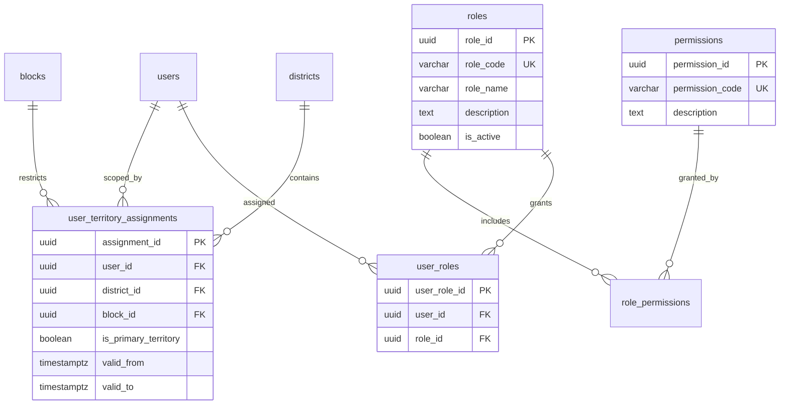
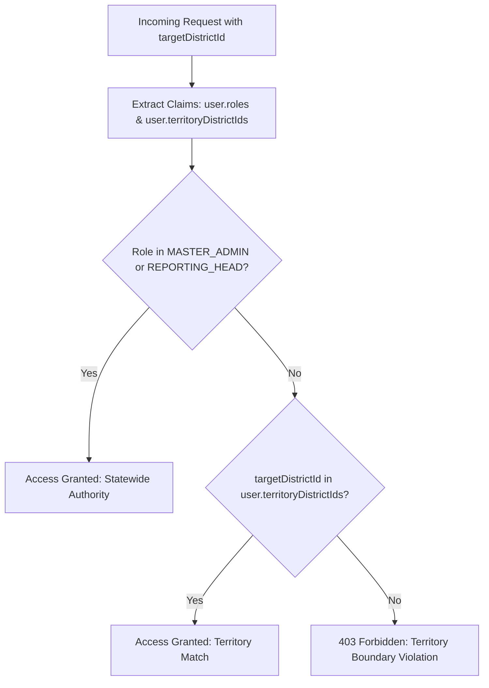
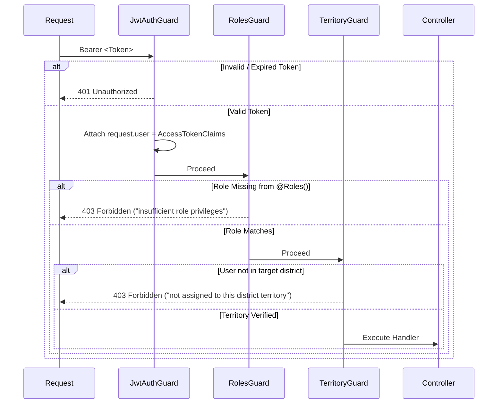
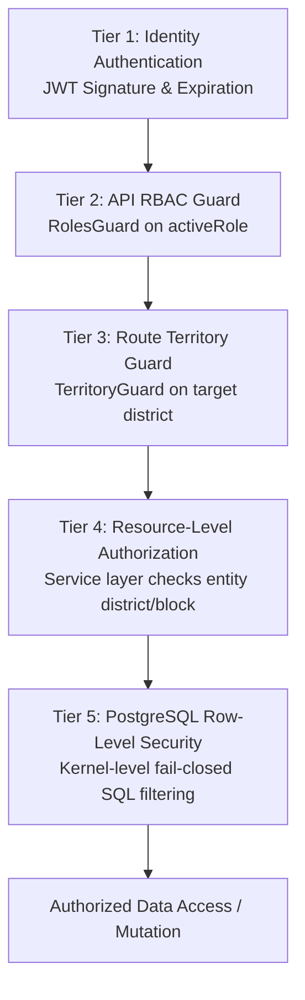

# ZENTRA — Role-Based Access Control (RBAC) & Territory Authorization Matrix
## Hi-Tech Lab Field Service Management Platform
### Authoritative Technical Specification — Phase 5: Authentication, Multi-District RBAC & Core API Foundation

---

## 1. Executive Summary & Authorization Principles

This document specifies the Role-Based Access Control (RBAC) and Multi-District Territory Scoping framework implemented in **Phase 5** of the **ZENTRA Hi-Tech Lab Field Service Management Platform**.

In field operations across 38 administrative districts in Tamil Nadu, access control requires a dual-axis authorization model:
1. **Vertical Functional Axis (RBAC)**: What capabilities and actions can a user perform based on their designated role?
2. **Horizontal Geographic Axis (Territory Scoping)**: In which districts and blocks is the user authorized to view or mutate entities?

### Core Authorization Principles:
- **Default Deny / Fail-Closed**: Every protected route rejects access unless valid credentials, active roles, and verified territory boundaries are confirmed.
- **Strict Role Segregation**: Coordinators in District A have zero visibility or mutation authority over schools or service cases in District B.
- **Statewide Administrative Elevation**: Global leadership (`MASTER_ADMIN` and `REPORTING_HEAD`) bypasses district boundaries for comprehensive state oversight.
- **Relational Integrity**: Role definitions, permissions, and territory assignments are normalized across relational tables in PostgreSQL (`roles`, `permissions`, `role_permissions`, `user_roles`, `user_territory_assignments`).

---

## 2. Canonical System Roles

| Role Code | Role Name | Hierarchy Level | Primary Scope | Operational Description |
|---|---|---|---|---|
| **`MASTER_ADMIN`** | State Master Administrator | System Level 0 | Statewide (All Districts) | Full administrative authority. Manages system configurations, master equipment catalogs, user accounts, and SLA policies. |
| **`REPORTING_HEAD`** | State Reporting Head | Executive Level 1 | Statewide (All Districts) | Read-only executive analytics and compliance oversight across all 38 districts. Cannot dispatch engineers or alter field evidence. |
| **`DISTRICT_COORDINATOR`** | District Service Coordinator | Operational Level 2 | District-Scoped (1+ Districts) | Manages case triage, engineer dispatching, and resolution sign-offs for schools within their assigned district(s). |
| **`FIELD_ENGINEER`** | Field Service Engineer | Field Level 3 | Block/District-Scoped | Executes on-site lab visits, captures GPS-tagged photos, logs equipment diagnostic readings, and resolves service tickets. |
| **`AI`** | Automated Background Worker | Service Level 0 | System / Global | Service identity for automated OCR ingestion, ticket deduplication, and anomaly classification engines. |
| **`HM`** | School Headmaster | Institutional Level 4 | Single School | Verifies engineer visit arrival and sign-off, confirms lab operational readiness. |

---

## 3. Normalized Database Schema

The RBAC subsystem is backed by 5 relational tables:

---

## 4. Comprehensive Role vs. Permission Matrix

| Permission Code | Description | `MASTER_ADMIN` | `REPORTING_HEAD` | `DISTRICT_COORDINATOR` | `FIELD_ENGINEER` | `AI` | `HM` |
|---|---|:---:|:---:|:---:|:---:|:---:|:---:|
| **`system:config`** | Manage system settings & environment | ✅ | ❌ | ❌ | ❌ | ❌ | ❌ |
| **`users:manage`** | Create and manage user accounts | ✅ | ❌ | ❌ | ❌ | ❌ | ❌ |
| **`audit:read`** | Inspect immutable audit logs | ✅ | ✅ | ❌ | ❌ | ❌ | ❌ |
| **`sla:manage`** | Configure SLA thresholds & policies | ✅ | ❌ | ❌ | ❌ | ❌ | ❌ |
| **`reports:statewide`** | View statewide analytics dashboards | ✅ | ✅ | ❌ | ❌ | ❌ | ❌ |
| **`reports:district`** | View district analytics dashboards | ✅ | ✅ | ✅ (Assigned) | ❌ | ❌ | ❌ |
| **`schools:read`** | View school profile and lab assets | ✅ | ✅ | ✅ (Assigned) | ✅ (Assigned) | ✅ | ✅ (Own) |
| **`schools:write`** | Update school contact & lab metadata | ✅ | ❌ | ✅ (Assigned) | ❌ | ❌ | ❌ |
| **`equipment:manage`** | Create & update equipment master types | ✅ | ❌ | ❌ | ❌ | ❌ | ❌ |
| **`complaints:import`** | Ingest legacy / helpline complaints | ✅ | ❌ | ❌ | ❌ | ✅ | ❌ |
| **`dispatch:manage`** | Assign engineers to service cases | ✅ | ❌ | ✅ (Assigned) | ❌ | ❌ | ❌ |
| **`service_cases:read`**| View service cases and history | ✅ | ✅ | ✅ (Assigned) | ✅ (Assigned) | ✅ | ✅ (Own) |
| **`service_cases:write`**| Update internal case priority/status | ✅ | ❌ | ✅ (Assigned) | ✅ (Assigned) | ❌ | ❌ |
| **`visits:execute`** | Check-in, log findings, check-out | ❌ | ❌ | ❌ | ✅ (Assigned) | ❌ | ❌ |
| **`evidence:upload`** | Upload GPS photo evidence | ❌ | ❌ | ❌ | ✅ (Assigned) | ❌ | ❌ |
| **`visits:verify`** | Headmaster sign-off on visit | ❌ | ❌ | ❌ | ❌ | ❌ | ✅ (Own) |

---

## 5. Multi-District & Multi-Block Territory Scoping Model

### 5.1 Assignment Hierarchy
Users are mapped to geographic boundaries in `user_territory_assignments`:
- **District Level**: `district_id` populated, `block_id = NULL`. Grants authority across all schools and blocks in that district.
- **Block Level**: `district_id` and `block_id` both populated. Limits authority to schools situated specifically in that block.
- **Multi-District Flexibility**: A single coordinator or senior engineer can hold multiple assignment records, allowing coverage across contiguous districts (e.g. Erode + Salem).
- **Temporal Validity**: Each assignment specifies `valid_from` and optional `valid_to`. Expired assignments are filtered out dynamically during authorization.

### 5.2 Territory Elevation Matrix

---

## 6. NestJS Guard Architecture

The authorization pipeline consists of three sequential guards:

### 6.1 `JwtAuthGuard`
- Extracts Bearer token from `Authorization` header.
- Validates cryptographic HMAC-SHA256 signature, 15m expiration window, and required claims.
- Populates `request.user` with `AccessTokenClaims`.

### 6.2 `RolesGuard` & The Active-Role Model
- Uses NestJS `Reflector` to retrieve metadata attached via `@Roles(...roles: UserRole[])`.
- Evaluates the caller's **`activeRole`** context (defaulting to the primary role).
- Confirms that the caller's `activeRole` matches one of the required roles.
- Returns 403 Forbidden with `"insufficient role privileges"` if the active role does not qualify.
- Prevents privilege bleeding when a single user is provisioned with multiple operational roles across distinct shifts or responsibilities.

### 6.3 `TerritoryGuard`
- Reads configuration from `@RequireTerritory({ paramName: 'districtId' })`.
- If user holds `MASTER_ADMIN` or `REPORTING_HEAD`, grants statewide bypass immediately.
- Extracts target district ID from `request.params`, `request.query`, or `request.body`.
- Confirms that `request.user.territoryDistrictIds` contains the target district.
- Throws 403 Forbidden if cross-district access is attempted.

---

## 7. Multi-District Resource-Level Authorization Chain

ZENTRA enforces access control through a coordinated 5-tier authorization chain:

1. **Tier 1 (Identity)**: Validates caller signature, token expiration, and non-revocation.
2. **Tier 2 (API RBAC)**: Enforces role permissions against caller's `activeRole`.
3. **Tier 3 (Territory Guard)**: Validates route parameters against assigned districts.
4. **Tier 4 (Resource Authorization)**: Verifies that specific queried entities (e.g., school record, lab equipment, service ticket) belong to an authorized district before applying business logic.
5. **Tier 5 (Database RLS)**: PostgreSQL executes security policies via `SET LOCAL zentra.current_user_id` and `SET LOCAL zentra.current_role`, preventing cross-district data leakage even if an application guard is misconfigured.

---

## 8. Automated Test Verification

The RBAC and territory scoping subsystem is verified in `apps/api/test/auth-security.spec.ts`:
- **Role Verification**: Proves `MASTER_ADMIN` succeeds on privileged endpoints while `FIELD_ENGINEER` receives 403 Forbidden.
- **`REPORTING_HEAD` Strict Monitoring**:
  - Proves `REPORTING_HEAD` succeeds in authenticating and reading statewide profiles.
  - Proves `REPORTING_HEAD` receives 403 Forbidden on administrative mutation endpoints (`/auth/demonstration/admin-only`).
  - Queries `role_permissions` in PostgreSQL to prove `REPORTING_HEAD` has strictly read/audit permissions (`schools:read`, `service_cases:read`, `audit:read`) and zero dispatch (`dispatch:manage`) or write permissions (`schools:write`, `service_cases:write`).
- **Territory Verification**: Proves Erode Coordinator succeeds on `/auth/demonstration/district-scoped/:erodeId` but receives 403 Forbidden when targeting Salem district.
- **Statewide Bypass**: Proves `MASTER_ADMIN` and `REPORTING_HEAD` successfully access both Erode and Salem endpoints regardless of specific territory assignment.
- **Dynamic RLS Staleness Defense**: Proves that updating `valid_to` in `user_territory_assignments` instantaneously revokes database row visibility on the next query without waiting for the 15-minute API token expiration.
