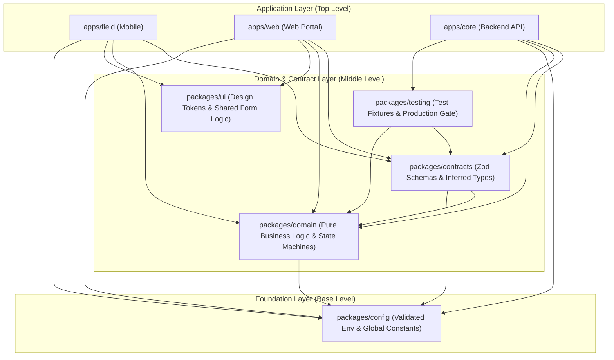

# ZENTRA — Repository & Monorepo Architecture Blueprint
## Hi-Tech Lab Field Service Management Platform

---

## 1. Monorepo Evaluation & Tooling Selection

ZENTRA consists of three distinct application surfaces (Mobile, Web, Backend) that share common domain logic, validation schemas, API contracts, and configuration standards. 

### 1.1 Tooling Evaluation

| Monorepo Tool | Workspace Management | Build Caching & Pipeline Pruning | TypeScript Integration | Suitability for React Native + Web + Backend | Verdict |
|---|---|---|---|---|---|
| **pnpm Workspaces + Turborepo** | Strict symlink isolation; content-addressable storage; fast installs. | Intelligent hashing; remote cache support; dependency-aware pipeline execution. | Native project references; zero duplicate packages. | Excellent. First-class React Native and Expo workspace support. | **RECOMMENDED PRIMARY** |
| **npm / Yarn Workspaces** | Hoisting conflicts; "phantom dependencies" where packages import unlisted deps. | Basic caching or none without external tools. | Slower typecheck across large workspaces. | Brittle when sharing React types between React Native and Web. | **REJECTED** |
| **Nx** | Powerful, but heavyweight plugins and steep learning curve. | Proprietary-leaning cloud cache. | Good. | Higher maintenance overhead for mid-sized engineering teams. | **REJECTED** |

> **Decision: Adopt `pnpm` (v9+) with `Turborepo` (v2+)**.
> - Enforces strict dependency isolation (preventing accidental imports of unlisted packages).
> - Drastically reduces disk usage and installation time via global content-addressable store.
> - Turborepo provides topological build execution (`pnpm run build`, `pnpm run test`, `pnpm run lint`) with instant cached replays.

---

## 2. Directory Layout & Architecture Blueprint

```text
zentra/
├── .github/                      # CI/CD Workflows, PR Templates, Issue Forms
│   └── workflows/
│       ├── ci.yml                # Main CI Pipeline (Lint, Typecheck, Test, Build)
│       ├── security.yml          # Automated Dependency & CodeQL Security Audit
│       └── release.yml           # Staged Tag & Release Pipeline
│
├── apps/                         # Application Deployables
│   ├── field/                    # ZENTRA Field: React Native (Expo CNG) Mobile App
│   │   ├── app.json              # Expo configuration & native plugins
│   │   ├── src/
│   │   │   ├── components/       # Mobile UI components (outdoor high-contrast)
│   │   │   ├── db/               # WatermelonDB models & SQLite schema
│   │   │   ├── queue/            # Local transaction & media upload queues
│   │   │   ├── screens/          # Screen controllers & navigation stacks
│   │   │   └── services/         # GPS gating, CameraX bridge, sync client
│   │   ├── package.json
│   │   └── tsconfig.json
│   │
│   ├── web/                      # ZENTRA Web: React + Vite Management Portal
│   │   ├── src/
│   │   │   ├── components/       # Data grids, diff modals, dispatch boards
│   │   │   ├── hooks/            # TanStack Query & table hooks
│   │   │   ├── pages/            # Admin, SLA, Ingestion, Reports screens
│   │   │   └── services/         # Core API client & auth session hooks
│   │   ├── vite.config.ts
│   │   ├── package.json
│   │   └── tsconfig.json
│   │
│   └── core/                     # ZENTRA Core: NestJS + Fastify Central Backend
│       ├── src/
│       │   ├── modules/          # Auth, Cases, Visits, Ingestion, Sync, SLA, Media
│       │   ├── guards/           # RBAC, Territory ABAC, Production Safety Guards
│       │   ├── database/         # Kysely DB connection & migration runners
│       │   └── worker/           # PG-Boss background worker daemon
│       ├── package.json
│       └── tsconfig.json
│
├── packages/                     # Shared Internal Workspace Packages
│   ├── contracts/                # Canonical API DTOs & Sync Mutation Schemas (Zod)
│   │   ├── src/
│   │   │   ├── auth/             # Login, token refresh, permit schemas
│   │   │   ├── cases/            # ServiceCase & SourceComplaint schemas
│   │   │   ├── visits/           # FieldVisit, GPS check-in, spares schemas
│   │   │   ├── sync/             # Delta sync push/pull request & conflict schemas
│   │   │   ├── imports/          # Staging record & diff preview schemas
│   │   │   └── index.ts
│   │   ├── package.json
│   │   └── tsconfig.json
│   │
│   ├── domain/                   # Pure Domain Models, State Machines & Constants
│   │   ├── src/
│   │   │   ├── enums.ts          # Operational status, visit outcomes, priority enums
│   │   │   ├── state-machine.ts  # Valid case state transition rules
│   │   │   ├── calculations.ts   # Haversine geofence & conveyance formula
│   │   │   └── index.ts
│   │   ├── package.json
│   │   └── tsconfig.json
│   │
│   ├── config/                   # Validated Environment & Application Configurations
│   │   ├── src/
│   │   │   ├── env.schema.ts     # Zod schema for environment variables
│   │   │   ├── constants.ts      # Immutable system constants
│   │   │   └── index.ts
│   │   ├── package.json
│   │   └── tsconfig.json
│   │
│   ├── ui/                       # Shared Headless UI Primitives & Design Tokens
│   │   ├── src/
│   │   │   ├── tokens.ts         # Outdoor high-contrast color palette & typography
│   │   │   └── index.ts
│   │   ├── package.json
│   │   └── tsconfig.json
│   │
│   └── testing/                  # Shared Test Utilities, Mocks & Factories
│       ├── src/
│       │   ├── factories/        # Deterministic seed data factories (Zero Prod PII)
│       │   ├── production-gate.ts# FAIL-CLOSED test gate script
│       │   └── index.ts
│       ├── package.json
│       └── tsconfig.json
│
├── docs/                         # Authoritative Architectural Specifications
├── infra/                        # Infrastructure, Local Docker Compose, Cloud Configs
│   ├── docker/
│   │   ├── docker-compose.yml    # Local PostgreSQL 16 + MinIO + Adminer
│   │   └── minio-init.sh         # Local S3 bucket provisioning
│   └── scripts/
│
├── scripts/                      # Developer Tooling & Verification Scripts
│   ├── verify-environment.ts     # Pre-flight environment validator
│   └── generate-openapi.ts       # Automated OpenAPI contract exporter
│
├── turbo.json                    # Turborepo Pipeline Configuration
├── pnpm-workspace.yaml           # pnpm Workspace Package Declarations
├── package.json                  # Root Monorepo Scripts & Dev Dependencies
└── tsconfig.base.json            # Base TypeScript Configuration
```

---

## 3. Dependency Direction & Architectural Boundaries

To preserve architectural integrity across teams, package dependencies must flow in a **strict, unidirectional hierarchy**:



---

## 4. Forbidden Imports & Dependency Governance Rules

Violating layer boundaries corrupts software maintainability. ZENTRA enforces **strict lint-enforced boundary rules** via ESLint (`eslint-plugin-import` / `@nrwl/eslint-plugin-nx` or `eslint-plugin-boundaries`):

### The 6 Forbidden Import Rules
1. **Rule 1: Mobile Must NEVER Import Backend Code**:
   - `apps/field` $\rightarrow$ `apps/core` is **STRICTLY FORBIDDEN**.
   - The mobile application interacts with backend capabilities exclusively through HTTP sync contracts. Importing backend files bundles server libraries (e.g., Kysely, Fastify, PG-Boss) into the mobile app, causing build crashes.
2. **Rule 2: UI Packages Must NOT Own Domain Business Rules**:
   - `packages/ui` $\rightarrow$ `packages/domain` is **STRICTLY FORBIDDEN**.
   - Design tokens, button components, and modal shells must remain pure visual abstractions. They must not contain ticket transition logic or SLA calculations.
3. **Rule 3: Database Implementation Details Must NOT Enter Shared Contracts**:
   - `packages/contracts` $\rightarrow$ Database ORM / Kysely drivers is **STRICTLY FORBIDDEN**.
   - Shared API contracts must only define wire DTOs and validation schemas (Zod). They must never import database connection pools, table schemas, or SQL query builders.
4. **Rule 4: Shared Packages Must NOT Import Applications**:
   - `packages/*` $\rightarrow$ `apps/*` is **STRICTLY FORBIDDEN**.
   - Shared packages must be strictly reusable and completely agnostic of specific applications.
5. **Rule 5: No Cyclic Dependencies**:
   - Circular imports between packages (`contracts` $\leftrightarrow$ `domain`) are strictly prohibited and blocked by Turborepo dependency graph validation.
6. **Rule 6: Web Must NOT Import Mobile Native Modules**:
   - `apps/web` $\rightarrow$ React Native / Expo libraries is **STRICTLY FORBIDDEN**.

---

## 5. TypeScript Configuration Strategy

ZENTRA enforces strict type safety across all workspaces through inherited TypeScript configurations:

### Base Configuration: `tsconfig.base.json`
```json
{
  "$schema": "https://json.schemastore.org/tsconfig",
  "compilerOptions": {
    "target": "ES2022",
    "module": "NodeNext",
    "moduleResolution": "NodeNext",
    "lib": ["ES2022"],
    "strict": true,
    "strictNullChecks": true,
    "strictFunctionTypes": true,
    "strictBindCallApply": true,
    "strictPropertyInitialization": true,
    "noImplicitAny": true,
    "noImplicitThis": true,
    "alwaysStrict": true,
    "noUnusedLocals": true,
    "noUnusedParameters": true,
    "noImplicitReturns": true,
    "noFallthroughCasesInSwitch": true,
    "noUncheckedIndexedAccess": true,
    "exactOptionalPropertyTypes": true,
    "esModuleInterop": true,
    "skipLibCheck": true,
    "forceConsistentCasingInFileNames": true,
    "declaration": true,
    "declarationMap": true,
    "sourceMap": true
  }
}
```

### Application Overrides
- `apps/field/tsconfig.json`: Extends `tsconfig.base.json`, overrides `jsx: "react-native"` and `moduleResolution: "bundler"`.
- `apps/web/tsconfig.json`: Extends `tsconfig.base.json`, overrides `lib: ["DOM", "DOM.Iterable", "ES2022"]`, `jsx: "react-jsx"`, and `moduleResolution: "bundler"`.
- `apps/core/tsconfig.json`: Extends `tsconfig.base.json`, retains `moduleResolution: "NodeNext"`, enables decorator metadata (`experimentalDecorators: true`, `emitDecoratorMetadata: true` for NestJS).

---

## 6. Turborepo Pipeline Definition (`turbo.json`)

```json
{
  "$schema": "https://turbo.build/schema.json",
  "tasks": {
    "build": {
      "dependsOn": ["^build"],
      "outputs": ["dist/**", ".next/**", "build/**"]
    },
    "typecheck": {
      "dependsOn": ["^build"],
      "outputs": []
    },
    "lint": {
      "dependsOn": ["^build"],
      "outputs": []
    },
    "test": {
      "dependsOn": ["^build"],
      "outputs": ["coverage/**"]
    },
    "test:security": {
      "outputs": []
    },
    "dev": {
      "cache": false,
      "persistent": true
    }
  }
}
```

---

## 7. Summary of Monorepo Architectural Enforcements

1. **Deterministic Single Source of Truth**: Data models, schemas, and API contracts are authored once in `packages/contracts` and imported across all surfaces.
2. **Compile-Time Safety Across Tier Boundaries**: Modifying an API payload schema immediately surfaces compile errors in both mobile and web clients during `pnpm run typecheck`.
3. **Hermetic Boundary Enforcement**: Automated linting prevents cross-tier architectural pollution (e.g., backend dependencies leaking into mobile bundles).
