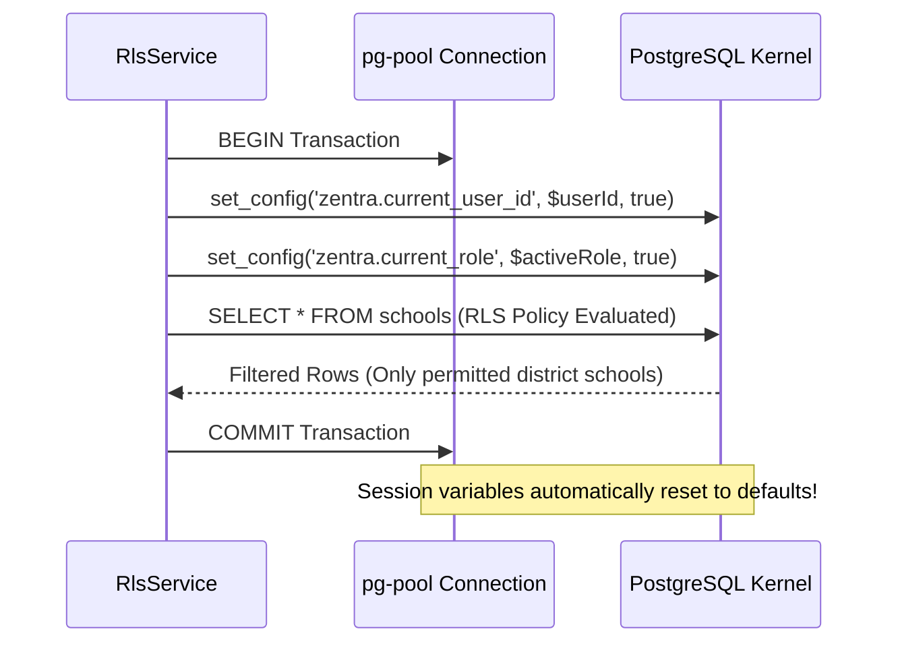

# ZENTRA — PostgreSQL Row-Level Security (RLS) Implementation
## Hi-Tech Lab Field Service Management Platform
### Authoritative Technical Specification — Phase 5: Authentication, Multi-District RBAC & Core API Foundation

---

## 1. Executive Summary & Purpose

This document provides the authoritative engineering specification for the PostgreSQL Row-Level Security (RLS) implementation in **Phase 5** of the **ZENTRA Hi-Tech Lab Field Service Management Platform**.

In educational infrastructure systems supporting thousands of schools across 38 administrative districts, software authorization guards at the API controller layer are necessary but insufficient on their own. ZENTRA adopts a **Defense-in-Depth** security architecture where the database kernel itself enforces territorial and role-based data isolation.

Even if an API handler contains an oversight or a developer omits a `WHERE district_id = ...` clause, the PostgreSQL engine filters returned rows at the storage level, rendering unauthorized records invisible and unmodifiable.

---

## 2. Core Architectural Principles

1. **Kernel-Enforced Isolation**: Security boundaries are anchored directly inside the PostgreSQL query planner and storage engine via RLS policies.
2. **Fail-Closed Default**: If a query is executed without explicit authenticated user and role session variables, the policies evaluate to `false`, returning **zero rows**.
3. **Zero Connection Pool Leakage**: Context parameters (`zentra.current_user_id` and `zentra.current_role`) are scoped strictly to individual database transactions using `set_config(..., is_local = true)`. Upon transaction completion (`COMMIT` or `ROLLBACK`), the context parameters are automatically reset, preventing state leakage across pooled connections.
4. **Table Owner & Non-Superuser Enforcement**: Tables enforce `FORCE ROW LEVEL SECURITY` so policies apply to table owners. Applications run under the non-superuser role `zentra_app` so superusers cannot bypass RLS.

---

## 3. Session Context Variables & Transaction Scoping

PostgreSQL RLS policies evaluate session settings set dynamically by the application layer:

| Setting Name | Type | Description |
|---|---|---|
| **`zentra.current_user_id`** | `uuid` (as text) | Surrogate identifier of the authenticated user performing the query. |
| **`zentra.current_role`** | `varchar(64)` | Active operational role context (`activeRole`) derived from the authenticated JWT session (`MASTER_ADMIN`, `REPORTING_HEAD`, `DISTRICT_COORDINATOR`, `FIELD_ENGINEER`, etc.). |

### The Active-Role Model in RLS Evaluation
In ZENTRA, a user may hold multiple roles across administrative and field duties. However, PostgreSQL RLS evaluates a single operational persona at query time via `zentra.current_role`:
- When generating the database transaction context, `RlsService` sets `zentra.current_role` to the token's `activeRole` (defaulting to the primary role).
- This ensures that if a user with dual roles (`DISTRICT_COORDINATOR` and `FIELD_ENGINEER`) acts as a Field Engineer, the database enforces engineer-level ticket scoping and does not leak coordinator-level district-wide tickets into the query result.
- Switching operational roles requires an active session transition, preserving strict audit separation.

### Connection Pool Safety Architecture
In Node.js applications with connection pooling (`pg-pool`), executing global `SET session_variable = value` causes settings to persist on the physical TCP connection. When that connection is returned to the pool and reused by another request, the second request inherits the prior identity.

ZENTRA eliminates connection-pool leakage through **transaction-bound local configuration**:
```sql
SELECT set_config('zentra.current_user_id', $1, true);
SELECT set_config('zentra.current_role', $2, true);
```
- The third parameter `true` marks the setting as `is_local`.
- In PostgreSQL, `is_local = true` restricts the setting's lifespan strictly to the enclosing transaction.
- When the transaction ends, PostgreSQL restores the connection to its clean default state.



---

## 4. Policy Definitions & Phase 5 Coverage Boundary

### 4.1 Phase 5 RLS Coverage Boundary
In Phase 5, PostgreSQL Row-Level Security policies are actively enforced on:
1. **`schools`** (district-level territorial isolation)
2. **`service_cases`** (assigned-engineer and district-level case isolation)

All other domain tables (`districts`, `blocks`, `hi_tech_labs`, `lab_equipment`, `source_complaints`, `field_visits`, `evidence_files`) are governed via relational foreign key lineage and API RBAC guards in Phase 5, and will receive dedicated RLS policies in subsequent domain implementation phases.

### 4.2 RLS on `schools` Table
```sql
ALTER TABLE schools ENABLE ROW LEVEL SECURITY;
ALTER TABLE schools FORCE ROW LEVEL SECURITY;

CREATE POLICY schools_territory_isolation ON schools
FOR ALL
USING (
  -- 1. Statewide administrative roles see all schools
  NULLIF(current_setting('zentra.current_role', true), '') IN ('MASTER_ADMIN', 'REPORTING_HEAD')
  OR
  -- 2. Scoped personnel see schools matching active territory assignments
  EXISTS (
    SELECT 1 FROM user_territory_assignments uta
    WHERE uta.user_id = NULLIF(current_setting('zentra.current_user_id', true), '')::uuid
      AND uta.district_id = schools.district_id
      AND (uta.block_id IS NULL OR uta.block_id = schools.block_id)
      AND (uta.valid_to IS NULL OR uta.valid_to > CURRENT_TIMESTAMP)
  )
);
```

#### Policy Logic Breakdown:
1. `current_setting('setting', true)`: The second argument `true` returns `NULL` instead of throwing an error if the setting is unset.
2. `NULLIF(..., '')`: Converts empty string to `NULL`, ensuring unauthenticated contexts fail safely.
3. `MASTER_ADMIN` and `REPORTING_HEAD`: Granted access to all schools across the state.
4. `DISTRICT_COORDINATOR`: If assigned to District A with `block_id = NULL`, they see all schools where `district_id = District A`.
5. `FIELD_ENGINEER`: If assigned to Block B in District A, they see only schools located in Block B.
6. Temporal Check: Assignments with expired `valid_to` timestamps are automatically excluded.

---

### 4.3 RLS on `service_cases` Table
```sql
ALTER TABLE service_cases ENABLE ROW LEVEL SECURITY;
ALTER TABLE service_cases FORCE ROW LEVEL SECURITY;

CREATE POLICY service_cases_territory_isolation ON service_cases
FOR ALL
USING (
  -- 1. Statewide administrative roles see all service cases
  NULLIF(current_setting('zentra.current_role', true), '') IN ('MASTER_ADMIN', 'REPORTING_HEAD')
  OR
  -- 2. Field Engineers see cases where they are primary or secondary engineer
  (
    NULLIF(current_setting('zentra.current_role', true), '') = 'FIELD_ENGINEER'
    AND (
      service_cases.assigned_primary_engineer_id = NULLIF(current_setting('zentra.current_user_id', true), '')::uuid
      OR service_cases.assigned_secondary_engineer_id = NULLIF(current_setting('zentra.current_user_id', true), '')::uuid
    )
  )
  OR
  -- 3. Coordinators see cases situated in schools within their assigned territory
  EXISTS (
    SELECT 1 FROM user_territory_assignments uta
    JOIN schools s ON s.school_id = service_cases.school_id
    WHERE uta.user_id = NULLIF(current_setting('zentra.current_user_id', true), '')::uuid
      AND uta.district_id = s.district_id
      AND (uta.block_id IS NULL OR uta.block_id = s.block_id)
      AND (uta.valid_to IS NULL OR uta.valid_to > CURRENT_TIMESTAMP)
  )
);
```

#### Policy Logic Breakdown:
1. **Administrative Oversight**: Leadership reviews all cases statewide.
2. **Field Engineer Scoping**: Field engineers only see cases assigned directly to them. Unassigned tickets or tickets assigned to colleagues in other districts remain completely inaccessible.
3. **Coordinator Territory Scoping**: District coordinators can inspect all service cases arising from schools located within their assigned district territory.

---

## 5. `RlsService` Implementation Architecture

In the NestJS backend, the `RlsService` provides a clean, transaction-safe API for executing scoped database operations:

```typescript
@Injectable()
export class RlsService {
  constructor(
    @Inject(DATABASE_CONNECTION)
    private readonly db: Kysely<DatabaseSchema>,
  ) {}

  async withSecurityContext<T>(
    context: SecurityContext,
    action: (trx: Transaction<DatabaseSchema>) => Promise<T>,
  ): Promise<T> {
    return await this.db.transaction().execute(async (trx) => {
      const userId = context.userId ?? '';
      const role = context.role ?? '';

      // Ensure transaction runs under non-superuser application role so PostgreSQL enforces RLS
      await sql`
        DO $$
        BEGIN
          IF EXISTS (SELECT 1 FROM pg_roles WHERE rolname = 'zentra_app') THEN
            PERFORM set_config('role', 'zentra_app', true);
          END IF;
        END $$;
      `.execute(trx);

      // Set transaction-local session variables for RLS evaluation
      await sql`SELECT set_config('zentra.current_user_id', ${userId}, true), set_config('zentra.current_role', ${role}, true)`.execute(trx);

      return await action(trx);
    });
  }

  async withUnauthenticatedContext<T>(
    action: (trx: Transaction<DatabaseSchema>) => Promise<T>,
  ): Promise<T> {
    return this.withSecurityContext({ userId: '', role: '' }, action);
  }
}
```

---

## 6. Dynamic Query Evaluation vs API Token Staleness

A critical security property of ZENTRA's RLS architecture is the temporal decoupling between API tokens and database authorization:

| Dimension | API Access Token Layer | PostgreSQL RLS Database Layer |
|---|---|---|
| **Lifespan** | 15 Minutes (`TTL = 900s`) | Per-Query / Per-Transaction (`is_local = true`) |
| **Revocation Latency** | Bounded delay (up to 15m) unless token is revoked | **Instantaneous / Zero Delay** |
| **Territory Source** | Static snapshot in JWT claims (`territoryDistrictIds`) | Dynamic query against `user_territory_assignments` table |

PostgreSQL evaluates the policy expression at SQL execution time:
```sql
WHERE uta.valid_to IS NULL OR uta.valid_to > CURRENT_TIMESTAMP
```
If an administrator revokes a coordinator's territory assignment or updates `valid_to` to the past:
1. The user's active API token still contains the old district ID in claims.
2. However, the very next database query executed through `RlsService` evaluates the current state of `user_territory_assignments`.
3. Because the territory record is expired or revoked in PostgreSQL, **the query immediately and instantaneously returns 0 rows**, providing true fail-closed data protection without waiting for token expiration.

---

## 7. Verification & Test Evidence

The PostgreSQL RLS subsystem is verified under automated integration tests in `apps/api/test/auth-security.spec.ts`:

1. **Statewide Visibility**: Verified that `MASTER_ADMIN` queries return schools and service cases across all districts ($N \ge 2$).
2. **`REPORTING_HEAD` Statewide Read**: Verified that `REPORTING_HEAD` queries return schools across all districts via RLS and via `/auth/demonstration/rls-schools`.
3. **District Isolation**: Verified that an Erode District Coordinator sees only schools with `district_id = District A` and zero schools from Salem (`district_id = District B`).
4. **Engineer Assignment Isolation**: Verified that a Field Engineer sees only their assigned case and cannot inspect unassigned cases in District B.
5. **Dynamic Territory Staleness**: Verified that setting `valid_to` to the past in `user_territory_assignments` immediately cuts off access to that district's schools on the very next query without re-issuing tokens.
6. **Fail-Closed Verification**: Verified that queries run under `withUnauthenticatedContext` return exactly **0 schools** and **0 service cases**.
7. **Connection Cleanliness**: Verified that a subsequent transaction on the same connection pool reverts to 0 rows, confirming zero context leakage across queries.
