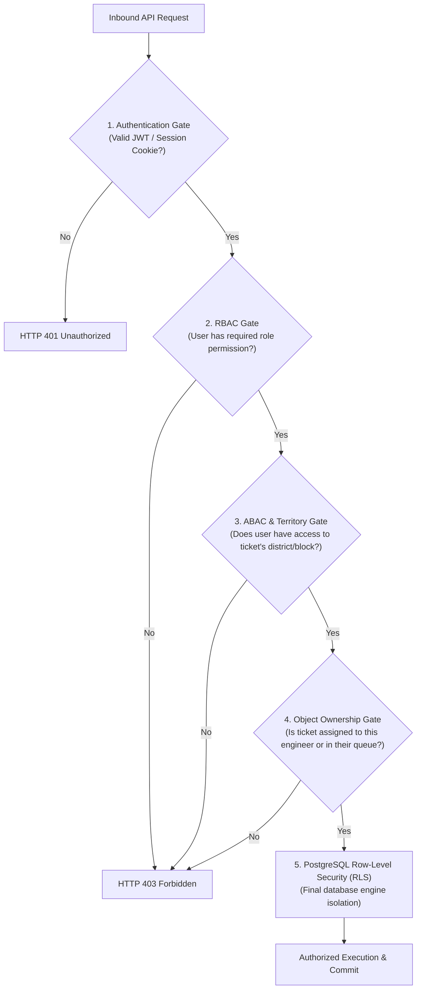
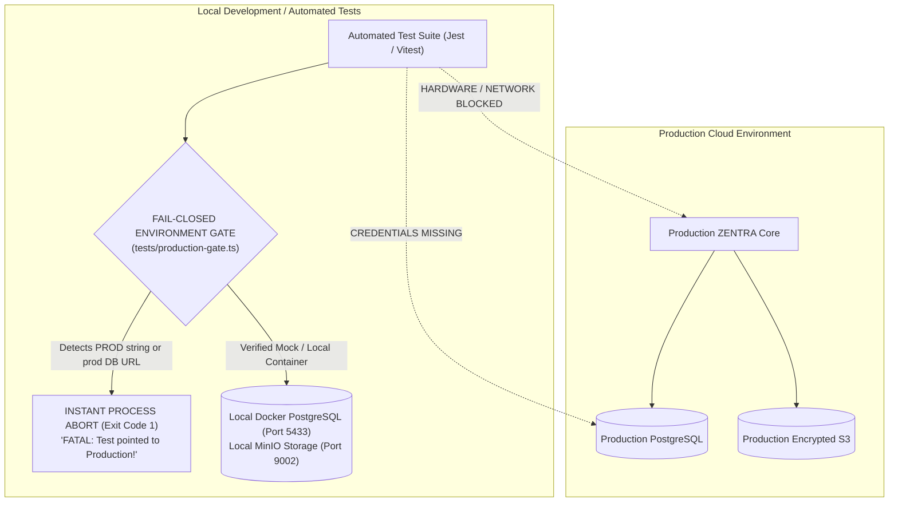

# ZENTRA — Security & Environment Architecture Specification
## Hi-Tech Lab Field Service Management Platform

---

## 1. Security Philosophy & The 10 Historical Defenses

ZENTRA's security architecture is built directly on forensics and hard lessons learned from previous system failures in government field deployments. Every security control is **strictly server-enforced**; client-side assertions of identity, territory, role, or state are treated as completely untrusted.

### The 10 Historical Failure Modes & ZENTRA's Structural Defenses

```mermaid
graph TD
    subgraph "Historical Failure Modes"
        H1["1. Whole-Dataset Replacement<br/>(Overwriting JSON/tables wipes data)"]
        H2["2. Test / Live Contamination<br/>(npm test wrote synthetic files to prod)"]
        H3["3. Secret & Header Exposure<br/>(Debug endpoints reflected tokens/headers)"]
        H4["4. PII Scraping / Harvest<br/>(Teacher phone numbers publicly exposed)"]
        H5["5. Large Media Transport Drops<br/>(1.4MB base64 timed out serverless hooks)"]
        H6["6. Deleted-Record Resurrection<br/>(Deleted tickets re-uploaded by offline sync)"]
        H7["7. Cross-District Data Leakage<br/>(Engineers accessing other districts' cases)"]
        H8["8. Client-Side Role Manipulation<br/>(Client claims admin role in request body)"]
        H9["9. Unauthorized Evidence Tampering<br/>(Replacing or purging signed HM reports)"]
        H10["10. Unsafe Bulk Ingestion<br/>(Direct spreadsheet parsing overwrote live ops)"]
    end

    subgraph "ZENTRA Structural Defenses"
        D1["Atomic Row-Level Transactions<br/>(PostgreSQL ACID; zero bulk collection replaces)"]
        D2["Fail-Closed Environment Boundaries<br/>(Test suites abort if prod env detected)"]
        D3["Zero-Header Reflection & Secret Vaults<br/>(Sanitized routes; KMS/Vault environment secrets)"]
        D4["Server-Side PII Masking & Auth Gates<br/>(HM/AI phone numbers scoped to assigned cases)"]
        D5["Direct Pre-Signed S3 Binary Streams<br/>(Decoupled media; zero base64 in JSON APIs)"]
        D6["Monotonic Tombstones & Purge Cursors<br/>(Deleted entities actively pruned from mobile)"]
        D7["PostgreSQL Row-Level Security (RLS)<br/>(Database engine enforces territory filtering)"]
        D8["Cryptographic Session / JWT Claims<br/>(Server verifies role & permissions per call)"]
        D9["Slot Isolation & Append-Only Audit<br/>(Slot 1 & Slot 2 independent; zero cross-delete)"]
        D10["Two-Phase Ingestion & Staging Diffs<br/>(Preview & approval gate before live commit)"]
    end

    H1 --> D1
    H2 --> D2
    H3 --> D3
    H4 --> D4
    H5 --> D5
    H6 --> D6
    H7 --> D7
    H8 --> D8
    H9 --> D9
    H10 --> D10
```



---

## 2. Server-Side Authentication & Authorization Boundaries

### 2.1 Multi-Tiered Access Control Architecture (RBAC + ABAC)
Authorization in ZENTRA combines **Role-Based Access Control (RBAC)** with **Attribute-Based Access Control (ABAC)**:



### 2.2 Role Matrix & Capability Boundaries

| Role | Operational Scope | Territory Boundary | Permitted Actions |
|---|---|---|---|
| **MASTER_ADMIN** | Global System Superuser | Statewide (All 38 Districts) | User provisioning, role assignment, configuration editing, audit inspection, system-wide overrides. |
| **REPORTING_HEAD** | Statewide Operations Lead | Statewide (All 38 Districts) | Executive analytics, cross-district reporting, SLA breach oversight, bulk dispatch approval. |
| **DISTRICT_COORDINATOR** | District Management | Assigned District(s) Only | Ingest complaints, dispatch tickets to engineers, review evidence, approve conveyance, manage district schools. |
| **FIELD_ENGINEER** | Physical Field Servicing | Assigned District(s) / Assigned Calls Only | View assigned calls, view assigned school contacts, log visits, capture GPS evidence, claim conveyance. |
| **AI / HM (School Staff)** | Institutional Reporter | Specific School UDISE Only | View status of own school complaints, upload initial symptom photo, verify lab readiness. |

---

## 3. Row-Level Security (RLS) & Territory Enforcement

To guarantee that engineers and coordinators cannot access complaints outside their authorized jurisdiction, ZENTRA enforces PostgreSQL **Row-Level Security (RLS)** at the database engine layer:

```sql
-- Conceptual PostgreSQL RLS Policy for Service Cases
ALTER TABLE service_cases ENABLE ROW LEVEL SECURITY;

CREATE POLICY service_case_territory_isolation ON service_cases
    AS RESTRICTIVE
    USING (
        -- 1. Master Admins and Reporting Heads have statewide visibility
        current_setting('jwt.claims.role', true) IN ('MASTER_ADMIN', 'REPORTING_HEAD')
        OR
        -- 2. District Coordinators see cases in their assigned districts
        EXISTS (
            SELECT 1 FROM user_territory_assignments uta
            JOIN schools s ON s.school_id = service_cases.school_id
            WHERE uta.user_id = current_setting('jwt.claims.user_id', true)::uuid
              AND uta.district_id = s.district_id
              AND uta.valid_to IS NULL
        )
        OR
        -- 3. Field Engineers see cases explicitly assigned to them
        (
            current_setting('jwt.claims.role', true) = 'FIELD_ENGINEER'
            AND (
                service_cases.assigned_primary_engineer_id = current_setting('jwt.claims.user_id', true)::uuid
                OR service_cases.assigned_secondary_engineer_id = current_setting('jwt.claims.user_id', true)::uuid
            )
        )
    );
```

> **Security Guarantee**: Even if an attacker tampers with API route parameters or injects raw SQL, the PostgreSQL database kernel rejects queries targeting records outside the authenticated user's territory.

---

## 4. Personally Identifiable Information (PII) Protection

Phase 0 discovery revealed that contact books containing the names, personal mobile numbers, and employee IDs of over 8,000 Headmasters and Lab Instructors were stored in unprotected spreadsheets.

### ZENTRA PII Protection Rules
1. **No Public Endpoint Exposure**: Under no circumstances may school contact lists be accessible on unauthenticated or public routes.
2. **Context-Restricted Visibility**:
   - A Field Engineer can view the phone number of a Headmaster or AI Teacher **only if** a `service_case` for that school is currently assigned to that engineer.
   - Global contact scraping is blocked by rate-limiting and access scoping.
3. **Audit Log Access Tracking**: Any administrative export or bulk view of school contact numbers generates a `PII_ACCESS_AUDIT` event recording the viewing user's ID, timestamp, and IP address.

---

## 5. Media & Evidence Security (Slot Isolation & Tamper Resistance)

Evidence files prove that public funds were legitimately expended on hardware repairs.

### Evidence Security Controls
1. **Pre-Signed Upload URLs with Expiration**:
   - Mobile clients never receive master storage credentials.
   - Clients request short-lived (5-minute expiry) pre-signed PUT URLs scoped strictly to a specific `evidence_file_id` and content-length limit (maximum 10MB).
2. **Cryptographic SHA-256 Checksums**:
   - The client calculates the file's SHA-256 hash before upload.
   - A server-side background worker computes the SHA-256 hash of the uploaded S3 object and compares it to the client manifest. If hashes mismatch, the file is rejected.
3. **Strict Slot Isolation**:
   - `Slot 1: HM Signed Completion Report` and `Slot 2: Equipment Working Photo` are stored under distinct S3 prefix paths.
   - The deletion or replacement API endpoint requires explicit slot parameterization:
     `DELETE /api/v1/cases/:id/evidence?slot=SLOT_2`
   - Modifying Slot 2 has **zero capability** to mutate or detach Slot 1.
4. **Permanent EXIF & Watermark Verification**:
   - Server-side inspection validates genuine EXIF GPS tags against reported check-in coordinates. If GPS metadata is missing or forged, the evidence is flagged as `SUSPICIOUS_INTEGRITY`.

---

## 6. Multi-Environment Isolation & Fail-Closed Test Gates

A disastrous vulnerability in legacy systems was that running `npm test` automatically connected to the live Google Drive and production database, creating synthetic test records (`PROBE AUTOMATION`) and uploading mock files to production school folders.

ZENTRA enforces an **Absolute Environment Isolation Boundary**:



### Environment Isolation Directives
1. **Zero Production Credentials in Source or Test Trees**:
   - Production connection strings and S3 access keys are managed exclusively through cloud secret managers (e.g., AWS Secrets Manager, HashiCorp Vault) and injected into production runtime containers at startup.
   - The test environment possesses **zero access** to production network subnets or IAM credentials.
2. **Fail-Closed Test Gate (`production-gate`)**:
   - Every test runner execution begins with an assertion verifying that `NODE_ENV === 'test'` and that `DATABASE_URL` matches local mock patterns (`localhost`, `127.0.0.1`, `test_db`).
   - If a test script detects a domain containing production hostnames, it immediately terminates with exit code 1 without sending a single network packet.

---

## 7. Rate Limiting, API Throttling & Network Defense

To prevent brute-force credential attacks, denial-of-service, or automated scraping:

| Endpoint Category | Rate Limit Policy | Action on Threshold Exceeded |
|---|---|---|
| **Authentication (`/api/v1/auth/login`)** | 5 requests per minute per IP | 15-minute IP lock; CAPTCHA requirement; audit alert logged. |
| **Token Refresh (`/api/v1/auth/refresh`)** | 30 requests per minute per user | Return HTTP 429; force re-authentication if anomaly persists. |
| **Mobile Delta Sync (`/api/v1/sync/*`)** | 120 requests per minute per device | Soft throttle with `Retry-After` header. |
| **Media Pre-Signed URLs (`/api/v1/media/*`)** | 60 requests per minute per user | Prevents bucket exhaustion and storage flooding. |
| **Administrative Bulk Export** | 10 requests per hour per user | Throttled; triggers `BULK_EXPORT_AUDIT` notification. |

---

## 8. Summary of Security Guarantees

1. **Zero Client Trust**: User roles, territory jurisdictions, and status transitions are validated exclusively by the server.
2. **Defense-in-Depth Isolation**: Database RLS prevents cross-district leaks even in the event of application logic flaws.
3. **Impenetrable Testing Isolation**: Production environments are mathematically and architecturally unreachable from automated test suites.
4. **Immutable Audit Lineage**: All critical operations (logins, dispatches, evidence uploads, deletions) generate permanent, append-only audit records.
