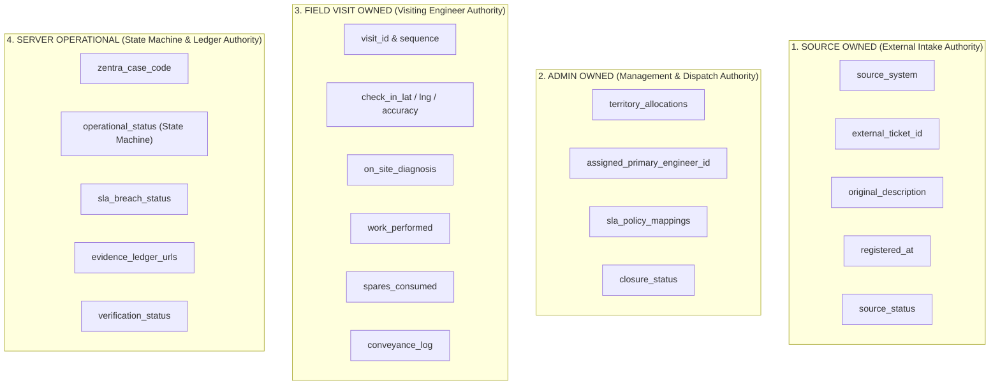
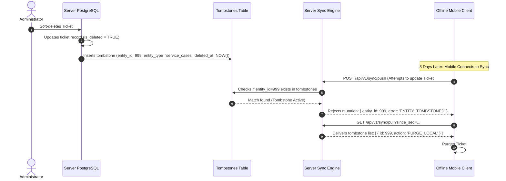

# ZENTRA — Synchronization & Conflict Architecture Specification
## Hi-Tech Lab Field Service Management Platform

---

## 1. Synchronization Philosophy & Core Tenets

In field service operations across rural Tamil Nadu, network disconnections are normal operational conditions rather than exceptions. ZENTRA's synchronization architecture is founded on four immutable principles:

1. **Strict Anti-Pattern Prohibition: NO WHOLE-DATASET REPLACEMENTS**:
   > [!CAUTION]
   > The legacy anti-pattern:
   > `Download entire database JSON -> Modify locally -> Replace entire database JSON`
   > is **strictly prohibited**. Whole-dataset replacement was the direct root cause of historical data wipes, race conditions, and test/live data corruption.
   > 
   > ZENTRA exclusively implements **Granular, Row-Level Delta Synchronization**.
2. **Domain-Owned Conflict Resolution (No Naive Last-Write-Wins)**:
   A simplistic "Last-Write-Wins" (LWW) strategy across entire records causes silent data loss (e.g., an offline engineer updating diagnostic notes overwriting an online admin's reassignment). ZENTRA assigns every data field to an authoritative **Ownership Domain** that governs conflict arbitration.
3. **Idempotent Operations with Monotonic Operation IDs**:
   Every mutation generated by the mobile client is uniquely identified by a client-generated `client_operation_id` (UUIDv7, combining high-resolution timestamps with cryptographic randomness). Re-transmitting the same operation produces zero duplicate side-effects on the server.
4. **Decoupled Data vs. Media Synchronization**:
   Lightweight relational data mutations (JSON deltas) and heavyweight binary media files (JPEG photos) are synchronized through independent pipelines to ensure that a slow or interrupted photo upload never stalls operational status updates.

---

## 2. Synchronization Topology & Lifecycle

The synchronization engine operates as a bidirectional pull/push state machine:

```mermaid
sequenceDiagram
    autonumber
    participant Client as ZENTRA Field (Local SQLite)
    participant Queue as Local Transaction Queue
    participant Sync as Mobile Sync Engine
    participant API as ZENTRA Core Sync API
    participant Engine as Server Conflict Resolver
    participant DB as Authoritative PostgreSQL

    Note over Client,DB: PHASE 1: CLIENT PUSH (UPSTREAM MUTATIONS)
    Sync->>Queue: Read pending mutations where sync_status='QUEUED'
    Sync->>API: POST /api/v1/sync/push<br/>{ client_id, last_sync_seq, mutations: [...] }
    API->>Engine: Process mutations against domain conflict rules
    Engine->>DB: Atomic batch commit (Row-level inserts/updates + Audit events)
    Engine-->>API: Result: { acknowledged_ids: [...], conflicts: [...] }
    API-->>Sync: Return HTTP 200 with batch acknowledgment
    Sync->>Queue: Mark acknowledged mutations as 'SYNCED'
    Sync->>Client: Reconcile local state with server conflict rulings

    Note over Client,DB: PHASE 2: SERVER PULL (DOWNSTREAM DELTAS)
    Sync->>API: GET /api/v1/sync/pull?since_seq=10492&territory_id=TVR
    API->>DB: Query entities mutated since sequence 10492 (including tombstones)
    DB-->>API: Return delta bundle (service_cases, assignments, tombstones)
    API-->>Sync: Return HTTP 200 { new_sync_seq: 10580, deltas: [...], tombstones: [...] }
    Sync->>Client: Apply deltas to local SQLite; purge tombstoned records
    Sync->>Client: Update local `last_sync_seq` watermark to 10580
```

---

## 3. Data Field Ownership Domain Matrix

To prevent cross-functional overwrites, all fields in the ZENTRA schema are partitioned into four **Ownership Domains**:



### Domain Authority Rules
1. **SOURCE OWNED**:
   - Sole Authority: External ticketing tool, helpline, or staged import job.
   - Field Engineers and District Coordinators have **zero write access**.
   - Offline mobile clients cannot submit mutations against these fields.
2. **ADMIN OWNED**:
   - Sole Authority: Authenticated District Coordinators, Operations Heads, and System Admins on ZENTRA Web.
   - If an admin reassigns a ticket, this assignment **unconditionally overrides** any local client assumption of assignment.
3. **FIELD VISIT OWNED**:
   - Sole Authority: The specific Field Engineer who physically attended the visit.
   - The server **never overrides** an engineer's recorded GPS coordinates, on-site multimeter readings, or work description.
4. **SERVER OPERATIONAL**:
   - Sole Authority: ZENTRA Core transactional backend.
   - Status transitions (e.g., transitioning from `VISIT_IN_PROGRESS` to `RESOLVED`) are governed by server-side state machine validation (e.g., verifying that both Slot 1 and Slot 2 evidence files exist before acknowledging `RESOLVED`).

---

## 4. Explicit Conflict Resolution Algorithms

ZENTRA enforces deterministic conflict arbitration rules across real-world edge cases:

### Conflict Case 1: Engineer Updates Service Case Offline While Admin Reassigns Case Online
- **Scenario**:
  - Monday 10:00 AM: Engineer Shameer goes offline with Ticket #4812 assigned to him.
  - Monday 11:30 AM: Admin reassigns Ticket #4812 to Engineer Priya on ZENTRA Web.
  - Monday 12:00 PM: Engineer Shameer arrives at the school offline, executes a physical visit, and logs diagnostic notes.
  - Monday 02:00 PM: Engineer Shameer regains network connectivity and pushes his mutation queue.
- **Arbitration Rule**: **FIELD VISIT PRESERVED + MULTI-ENGINEER MERGE**.
  - The server **accepts and commits Shameer's `field_visit` record**, because physical work was genuinely performed at the school.
  - The server **preserves Priya as the current assigned engineer** (`assigned_primary_engineer_id` is ADMIN OWNED).
  - The server transitions Priya's assignment to include Shameer's completed visit in the ticket history.
  - An audit notification is dispatched to the District Coordinator: `"Visit logged by prior assignee (Shameer) on case reassigned to Priya"`.
  - **Verdict**: Zero physical work is lost; administrative authority is respected.

---

### Conflict Case 2: Source Spreadsheet Re-imported While Field Service is In-Progress
- **Scenario**:
  - An updated department spreadsheet is imported on ZENTRA Web.
  - The spreadsheet contains Ticket #4812, with source status still marked `"Open"` and a slightly modified description string.
  - Meanwhile, Engineer Shameer has already marked the case `"VISIT_IN_PROGRESS"` on-site.
- **Arbitration Rule**: **SOURCE ISOLATION (ZERO FIELD CONTAMINATION)**.
  - The import engine updates the `source_complaints` record (`source_status = 'Open'`, updated raw text).
  - The `service_cases` operational record remains strictly untouched (`operational_status = 'VISIT_IN_PROGRESS'`).
  - Shameer's local mobile device receives no conflicting state mutation.
  - **Verdict**: External spreadsheet updates cannot disrupt active field execution.

---

### Conflict Case 3: Two Engineers Submit Visits for the Same Case (Team Servicing)
- **Scenario**:
  - Two engineers attend a major lab breakdown together (e.g., 20 network cables damaged).
  - Both engineers log visits on their respective mobile devices while offline.
- **Arbitration Rule**: **MULTI-VISIT ACCRETION**.
  - Because `field_visits` are independent child records (`service_case 1:N field_visits`), both mutations represent valid, separate entities.
  - The server commits Engineer A's visit as `visit_sequence_number = 1` and Engineer B's visit as `visit_sequence_number = 2`.
  - Both conveyance claims and spares consumed are credited to the respective engineers.
  - **Verdict**: No collision; the service case aggregates both visits cleanly.

---

### Conflict Case 4: Field Engineer Submits Offline Completion But Evidence File Upload Fails
- **Scenario**:
  - Engineer marks a case `"RESOLVED"` on mobile and queues Slot 1 and Slot 2 photos.
  - During sync, the JSON visit data reaches the server, but cellular connection drops before the 3MB photo binary completes uploading.
- **Arbitration Rule**: **INTERMEDIATE STATE GATING (`PENDING_EVIDENCE`)**.
  - The server **commits the `field_visit` data**, but **refuses to transition the `service_case` to `RESOLVED`**.
  - Instead, the case transitions to `PENDING_EVIDENCE_UPLOAD`.
  - The server responds with `{ acknowledged: true, case_status: 'PENDING_EVIDENCE_UPLOAD', missing_evidence: ['SLOT_2'] }`.
  - The mobile client retains the photo in its local media queue and displays an amber indicator: `"Visit recorded; awaiting photo sync"`.
  - When connection is restored, the photo uploads, the server confirms receipt, and the case transitions to `RESOLVED`.
  - **Verdict**: Prevents premature closure claims without permanent evidence.

---

## 5. Idempotency & Duplicate Sync Prevention

In rural cellular networks, HTTP responses are frequently lost even when the server successfully processed the request (TCP connection reset after server commit).

### Client Operation ID Protocol
1. Every mutation created on mobile generates a **Client Operation ID** using the `UUIDv7` specification.
2. The server maintains an `idempotency_keys` ledger in PostgreSQL:
   ```sql
   CREATE TABLE idempotency_keys (
       client_operation_id UUID PRIMARY KEY,
       user_id UUID NOT NULL,
       endpoint VARCHAR(128) NOT NULL,
       response_status_code INT NOT NULL,
       response_body JSONB NOT NULL,
       created_at TIMESTAMP WITH TIME ZONE DEFAULT CURRENT_TIMESTAMP
   );
   ```
3. When the mobile client retries an unconfirmed mutation:
   - The server detects the existing `client_operation_id`.
   - The server **does not re-execute the mutation**.
   - The server returns the cached `response_body` with HTTP 200.
4. **Guarantee**: Retrying a sync push 10 times produces exactly one database commit.

---

## 6. Tombstone Synchronization (Preventing Record Resurrection)

A severe defect observed in legacy field systems was the **resurrection of deleted tickets**: an administrator deleted a mistaken test ticket on the web, but an offline mobile client synced 3 days later, re-uploaded its cached copy, and restored the deleted ticket to production.

ZENTRA prevents resurrection via **Tombstone Propagation**:



---

## 7. Summary of Sync Architectural Guarantees

| Failure Scenario | Legacy Behavior | ZENTRA Architectural Defense |
|---|---|---|
| Concurrent Admin & Engineer Edits | Admin edit wiped by engineer's local copy | Field visit merged; admin assignment preserved. |
| Re-import of External Spreadsheet | Wiped assigned engineer and notes | `source_complaints` updated; field execution untouched. |
| Disconnected Retry Storm | Duplicate tickets and visits created | Monotonic `UUIDv7` idempotency deduplicates calls. |
| Deletion of Erroneous Ticket | Resurrected when engineer reconnected | Tombstones actively purge local client records. |
| Dropped Connection Mid-Photo | Corrupted ticket state; lost IDs | Media decoupled; case held in `PENDING_EVIDENCE_UPLOAD`. |
| Whole-Database Replacement | Catastrophic data wipe | Prohibited; 100% row-level delta sync. |
