# ZENTRA — Technology Foundation & Architecture Evaluation
## Hi-Tech Lab Field Service Management Platform

---

## 1. Purpose & Scope

The purpose of this document is to evaluate the technology baseline established in Phase 1 against the stringent operational realities of **ZENTRA — Hi-Tech Lab Field Service Management Platform**.

In Phase 1, a candidate technology stack was proposed:
- Mobile: React Native with TypeScript and WatermelonDB / SQLite.
- Web: React 18+ with TypeScript, Vite, and Tailwind CSS.
- Backend: NestJS with Fastify and TypeScript.
- Database: PostgreSQL 16+ with Row-Level Security (RLS).
- Storage: S3-compatible Object Storage (MinIO local / AWS S3 production).
- Background Jobs: PG-Boss (PostgreSQL-backed daemon).
- Authentication: Short-lived access tokens with cryptographic refresh tokens and Android Keystore.
- Validation: Zod runtime validation schemas shared across all tiers.

Phase 2 must **rigorously validate, test, and justify or adapt** each choice against real-world field constraints rather than accepting them on familiarity.

---

## 2. Evaluation Against the 12 Real-World Operational Criteria

Every architectural component is evaluated across 12 concrete field and enterprise dimensions:

```mermaid
graph TD
    Crit["12 Operational Evaluation Criteria"]
    Crit --> C1["1. User's Actual Field Environment (Sunlight, Dust, Bike Transit)"]
    Crit --> C2["2. Low/Mid-Range Android Devices (2GB-4GB RAM, MediaTek/Snapdragon 600)"]
    Crit --> C3["3. Offline Operation (Multi-hour/multi-day zero connectivity)"]
    Crit --> C4["4. Rural Tamil Nadu Connectivity (Edge 2G, high latency, packet loss)"]
    Crit --> C5["5. Long-Term Maintainability (Single language, stable LTS)"]
    Crit --> C6["6. Development Complexity (Manageable team cognitive load)"]
    Crit --> C7["7. Local Development Simplicity (Fast onboarding, Dockerized dependencies)"]
    Crit --> C8["8. Security (Server-enforced RBAC, encrypted credentials, zero leakage)"]
    Crit --> C9["9. Cost (Zero recurring per-seat vendor tax; open standards)"]
    Crit --> C10["10. Future Scalability (38 Districts, 8,209 asset/status records baseline, 50,000+ Annual Visits)"]
    Crit --> C11["11. Testing Complexity (Deterministic mockability, fail-closed isolation)"]
    Crit --> C12["12. Deployment Complexity (Independent CI/CD pipelines, repeatable releases)"]
```

---

## 3. Critical Mobile Architecture Decision: React Native Workflow

### 3.1 The Four Mobile Workflow Candidates

ZENTRA Field requires native hardware integration:
- High-accuracy continuous GPS tracking with $\le 50\text{ m}$ threshold gating.
- Rear-facing camera viewfinder with metadata watermark burning.
- Native SQLite database access via JavaScript Interface (JSI) for low memory overhead.
- Direct-to-S3 binary streaming uploads.
- Resilient background task execution across Android battery-saver modes.

We evaluate four execution workflows:

| Workflow Option | Native Module Compatibility (WatermelonDB / CameraX) | Background Service Reliability | Development Velocity | Upgrade & Maintenance Risk | Verdict |
|---|---|---|---|---|---|
| **A. Expo Managed Workflow** | **POOR**: Custom JSI SQLite engines and native EXIF injectors cannot run without native custom code. | **POOR**: Background execution restricted to standard Expo tasks; OS kills long upload queues. | High initial velocity | High: Blocked whenever a third-party native library lacks an Expo config plugin. | **REJECTED** |
| **B. Expo Development Client (Dev Builds)** | **EXCELLENT**: Native code compiled into custom client; supports arbitrary native libraries. | **GOOD**: Native Android foreground services can be declared via config plugins. | High: Fast OTA updates for JS; managed build environment. | Moderate: Upgrades tied to Expo SDK cycle (every ~4 months). | **STRONG CANDIDATE** |
| **C. Expo Prebuild (Continuous Native Generation - CNG)** | **MAXIMUM**: Native `android/` directory is generated deterministically from config plugins. Zero manual Gradle editing. | **EXCELLENT**: Native manifest entries and foreground services configured via version-controlled plugins. | Very High: Clean git tree without monolithic brittle `android/` hacks. | Low: Deterministic regeneration prevents native bit-rot across SDK bumps. | **RECOMMENDED PRIMARY** |
| **D. React Native Bare** | **MAXIMUM**: Full manual control of Android Studio project and Gradle scripts. | **MAXIMUM**: Handcrafted native services. | **LOW**: High maintenance; brittle manual native dependency linking; Gradle synchronization conflicts. | **HIGH**: Upgrading React Native versions requires painful manual diffing of hundreds of native files. | **REJECTED AS PRIMARY** |

### 3.2 Authoritative Mobile Decision

> **DECISION: Adopt React Native with Expo Prebuild (Continuous Native Generation - CNG) and Custom Dev Clients.**
>
> **Rationale**:
> 1. **Zero Git Bloat & Deterministic Native Code**: The native `android/` directory is generated programmatically on demand using `npx expo prebuild`. Developers never commit brittle, unmaintainable Android Studio diffs to version control.
> 2. **Native Power Without Bare Pain**: ZENTRA Field uses native C++ / JSI modules for SQLite (WatermelonDB / `op-sqlite`) and native CameraX/FusedLocation via Expo Config Plugins.
> 3. **Repeatable Release Builds**: CI/CD compiles the Android APK/AAB deterministically from `app.json` configuration plugins.

---

## 4. Comprehensive Technology Stack Evaluation & Recommendations

### 4.1 Mobile Application: ZENTRA Field
- **Recommended Technology**: **React Native (0.76+ with New Architecture) + TypeScript + Expo Prebuild (CNG)**.
- **Local Storage Engine**: **WatermelonDB on SQLite via JSI**.
- **Camera & Location Engine**: Native CameraX bridge via custom config plugin; Android Fused Location Provider.
- **Network State**: `@react-native-community/netinfo`.
- **Credential Vault**: `expo-secure-store` backed by Android Keystore (hardware-backed Keystore / StrongBox).

### 4.2 Web Management Application: ZENTRA Web
- **Recommended Technology**: **React 18+ / 19 + TypeScript + Vite + Tailwind CSS**.
- **State Management & Server Cache**: **TanStack Query (React Query v5)** for deterministic server cache invalidation.
- **Data Grids & Filtering**: **TanStack Table v8** (headless, high-performance table engine handling 5,000+ staged records with zero UI freeze).
- **Routing**: **React Router v6/v7**.
- **Form Management & Validation**: **React Hook Form + Zod**.

### 4.3 Central Backend Engine: ZENTRA Core
- **Recommended Technology**: **Node.js (LTS v22+) + NestJS 11 + Fastify + TypeScript**.
- **HTTP Engine**: Fastify HTTP adapter (up to $2\times$ throughput and lower latency compared to Express).
- **Query Builder & Data Access**: **Kysely (TypeScript SQL Query Builder)**.
  - *Evaluation Note*: We evaluate Kysely over Prisma and TypeORM. Kysely produces zero runtime overhead, generates explicit, auditable raw SQL, provides full TypeScript compile-time type safety derived directly from database schema, and allows granular control of Row-Level Security (RLS) queries and transactional boundaries.
- **Runtime Validation**: **Zod** (validates all inbound HTTP requests, query params, and sync payloads at trust boundaries).

### 4.4 Authoritative Relational Database
- **Recommended Technology**: **PostgreSQL 16+**.
- **Spatial Extensions**: **PostGIS** (optional for school gate geofencing calculations; standard mathematical Haversine or PostGIS functions).
- **Security Primitives**: Native **Row-Level Security (RLS)** policies enforcing district/block territory isolation at the database kernel.
- **Dynamic Equipment Modeling**: **JSONB** with GIN indexing for dynamic hardware attributes (`equipment_attribute_definitions`).

### 4.5 Object & Media Storage
- **Recommended Technology**: **S3-Compatible Object Storage Abstraction**.
  - Local Development & CI: **MinIO** (Docker container running on port 9000/9001).
  - Staging & Production: **AWS S3** or **Cloudflare R2** (zero egress fees for heavy photographic inspection).
- **Upload Mechanism**: Pre-signed `PUT` URLs generated by ZENTRA Core with strict 5-minute expiration, content-length constraints, and SHA-256 hash assertions.

### 4.6 Background Processing & Queues
- **Recommended Technology**: **PG-Boss (PostgreSQL-Backed Job Queue)**.
  - *Evaluation Note*: Evaluated against Redis + BullMQ.
  - **Verdict**: PG-Boss eliminates the operational complexity, memory costs, and failover fragility of maintaining a separate Redis cluster. It runs natively within PostgreSQL transactions, designed so that queuing a job (e.g., SLA escalation or import parsing) commits atomically with database state.

### 4.7 End-to-End Type Safety & Shared Contracts
- **Recommended Technology**: **`packages/contracts` using Zod + TypeScript**.
  - Zod schemas serve as the single source of truth.
  - TypeScript types are inferred automatically using `z.infer<typeof Schema>`.
  - OpenAPI specifications are generated programmatically for API documentation.

---

## 5. Technology Evaluation Matrix & Trade-Off Analysis

| Layer | Recommended Choice | Alternatives Evaluated | Why Chosen | Trade-Offs / Mitigations |
|---|---|---|---|---|
| **Mobile Framework** | React Native (Expo CNG) | Flutter, Native Android | 100% shared TypeScript domain contracts; native SQLite JSI; CameraX. | Native build complexity mitigated by continuous prebuild plugins. |
| **Local Mobile DB** | WatermelonDB (SQLite) | Realm, AsyncStorage | Lazy loading; reactive observables; low RAM consumption on budget devices. | Requires strict local schema migration discipline. |
| **Backend Framework**| NestJS + Fastify | Express, Go, FastAPI | Enterprise structure; DI; Fastify throughput; shared Zod validation. | Higher initial architectural structure than flat scripts. |
| **Database Access** | Kysely Query Builder | Prisma, TypeORM | Explicit SQL control; zero ORM memory bloat; compile-time types; native RLS. | Developers write SQL-like queries instead of high-level object models. |
| **Object Storage** | S3-Compatible (MinIO/S3)| Local filesystem, GDrive| Resumable pre-signed uploads; high concurrency; decoupled from API. | Requires two-phase commit (request upload -> upload -> confirm). |
| **Background Queue** | PG-Boss | Redis BullMQ, RabbitMQ| No extra Redis infrastructure; atomic transactional enqueuing in PostgreSQL. | Higher PostgreSQL write load; mitigated by separate worker connections. |

---

## 6. Summary of Phase 2 Technology Foundation Architectural Specifications

1. **Unified Language Stack**: 100% TypeScript across Mobile, Web, Backend, and Shared Contracts.
2. **Operational Durability**: Designed specifically for low-end Android phones, intermittent connectivity, and rural dust/sunlight conditions.
3. **Zero Vendor Lock-In**: Open-source, self-hostable core (Node.js, PostgreSQL, MinIO) deployable to any cloud or on-premise infrastructure.
4. **Zero Legacy Entanglement**: Completely independent of Google Apps Script, Google Sheets, or legacy Node.js monolithic scripts.
