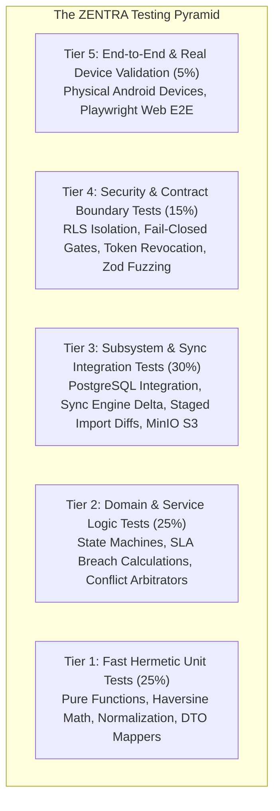

# ZENTRA — Testing Strategy & Quality Assurance Blueprint
## Hi-Tech Lab Field Service Management Platform

---

## 1. Quality Assurance Philosophy & Testing Pyramid

ZENTRA enforces an automated, multi-tiered testing pyramid designed to ensure maximum operational durability for both field engineering edge devices and central management platforms.



---

## 2. The 13 Core Testing Categories

Every component of ZENTRA is architected to be tested against its corresponding tier during implementation:

| # | Testing Category | Target Subsystem | Testing Scope & Assertions | Tooling |
|---|---|---|---|---|
| **1** | **Unit Tests** | `packages/*`, Pure Utils | Pure function correctness, date formatting, Haversine formula, currency calculations. | Vitest |
| **2** | **Domain/Service Tests** | `packages/domain`, Backend Services | State machine transitions, SLA breach duration calculations, valid assignment rules. | Vitest |
| **3** | **API Integration Tests** | `apps/core` (REST Controllers) | HTTP contract compliance, Zod schema validation pipes, HTTP error status envelopes. | Supertest / Fastify Inject |
| **4** | **Database Integration Tests** | `apps/core` (Kysely Services) | ACID transaction rollbacks, foreign key cascades, JSONB GIN index queries. | Vitest + Local Docker Postgres |
| **5** | **RLS Authorization Tests** | PostgreSQL Security Kernel | Cross-district query isolation; asserts that District Coordinator A receives 0 rows for District B. | Vitest + Test DB Pool |
| **6** | **Sync Protocol Tests** | `apps/core` & `apps/field` Sync Engine | Monotonic sequence cursors, idempotency key deduplication, delta packet construction. | Vitest (Mock SQLite & Postgres) |
| **7** | **Conflict Resolution Tests** | Conflict Resolver | 4 domain conflict cases (Admin reassignment vs Offline visit, Re-import vs Field work, etc.). | Vitest Domain Test Suite |
| **8** | **Import Staging Tests** | Ingestion Engine | 5-Tier duplicate classification, malformed header detection, boundary wall protection. | Vitest + Fixture Spreadsheets |
| **9** | **Media Upload Tests** | Object Storage Service | Pre-signed URL generation, S3 ETag confirmation, SHA-256 hash assertions, slot isolation. | Vitest + Local MinIO |
| **10**| **Mobile Offline Tests** | `apps/field` | WatermelonDB local queries, transaction queue persistence, offline work permit validation. | Jest + React Native Testing Library |
| **11**| **End-to-End (E2E) Tests** | Web & Core Integration | Full administrative lifecycle: Ingest -> Stage -> Approve -> Dispatch -> Verify -> Close. | Playwright |
| **12**| **Security Tests** | Auth & Middleware | Rate limiting, brute-force IP throttling, PII masking, secret reflection absence. | Supertest + Security Suite |
| **13**| **Performance Tests** | Backend & Database | Sync batch latency under 500 concurrent mobile nodes; 10,000-row spreadsheet ingestion throughput. | k6 |

---

## 3. Dedicated Mobile Testing Foundation (`apps/field`)

Field testing cannot be limited to simulated happy paths in desktop browsers. ZENTRA Field enforces a comprehensive mobile failure matrix:

### 3.1 Simulated vs. Physical Device Testing Matrix

| Operational Failure Scenario | Testing Execution Method | Test Setup & Assertions |
|---|---|---|
| **1. Offline App Launch** | Simulated (Mock SQLite) & Physical Device | Launch app with WiFi/Cellular disabled. Assert that assigned calls and school dossier render within 1 second from local WatermelonDB. |
| **2. Airplane Mode Transition** | Simulated & Physical Device | Toggle network off mid-operation. Record on-site diagnosis; assert that write commits to local queue without crashing. |
| **3. Android Process Kill (OOM)** | Simulated (Jest) & Physical Device | Use `adb shell am kill` while form is being filled. Reopen app; assert that diagnostic draft restores completely. |
| **4. Device Reboot Mid-Visit** | Physical Device (`adb reboot`) | Check in, reboot device, reopen app. Assert that active visit banner displays elapsed time and retains check-in GPS. |
| **5. Low Battery Throttling** | Physical Device (Battery < 10%) | Verify that Camera viewfinder and GPS stream do not crash under OS CPU throttling. |
| **6. Intermittent Network Mid-Sync**| Simulated (Network throttling proxy) | Inject 50% packet loss and 2000ms latency. Assert that media uploads pause gracefully and resume from last byte offset. |
| **7. Duplicate Sync Retry Storm** | Simulated (Unit/Integration test) | Transmit identical `client_operation_id` 10 times consecutively. Assert that server commits exactly 1 visit record. |
| **8. Failed Media Upload Retry** | Simulated & Physical Device | Simulate S3 network drop during photo upload. Assert that visit data commits with status `PENDING_EVIDENCE_UPLOAD` while photo queue retries. |
| **9. Inaccurate GPS (> 50m)** | Simulated & Physical Device | Mock GPS accuracy at 85m. Assert that camera shutter button is strictly disabled with HUD warning banner. |
| **10. Token Expiry While Offline** | Simulated (Clock fast-forward) | Expire JWT access token while offline. Assert that `offline_work_permit` allows continued field execution for up to 14 days. |
| **11. Concurrent Admin Reassignment** | Simulated Integration Test | Reassign ticket on server while mobile is offline. Sync mobile; assert that field visit is preserved in ticket history. |

---

## 4. Dedicated Web Testing Foundation (`apps/web`)

Testing for ZENTRA Web focuses on **administrative governance, data leak prevention, and human-in-the-loop validation**:

### 4.1 Strict Cross-District Leak Prevention Tests
To ensure that District Coordinators never view or export complaints belonging to other territories:
1. **Grid Query Isolation**: Authenticate as `coord_nagapattinam`. Request `/api/v1/cases`. Assert that all returned records have `district = 'Nagapattinam'`.
2. **Search Filter Leak Test**: Execute global search query `PUMS` across all schools. Assert that search results exclude schools from Thiruvarur or Chennai.
3. **Export Scrubbing Test**: Trigger CSV/Excel report export. Assert that exported spreadsheet contains zero rows from unauthorized districts.
4. **Direct URL Tampering Test**: Navigate to `/cases/01925b42-thiruvarur-case-id` while logged in as Nagapattinam coordinator. Assert that UI renders a 403 Forbidden screen.

### 4.2 Import Staging & Diff Approval Tests
- Upload a synthetic Excel file with 5 unique calls, 2 duplicate calls, and 1 malformed row.
- Assert that preview modal accurately categorizes all 8 rows.
- Assert that production `source_complaints` table remains empty until the administrator clicks "Approve".

---

## 5. Test Data Factories & Hermetic Fixtures

In strict adherence to Phase 2 safety directives:
> [!IMPORTANT]
> **ZERO REAL PRODUCTION PII IN TEST CODE.**
> All test fixtures must be generated programmatically using synthetic deterministic factories.

```typescript
// packages/testing/src/factories/school.factory.ts
export function createMockSchool(overrides?: Partial<SchoolDto>): SchoolDto {
  return {
    school_id: overrides?.school_id || '01925b42-8e11-7a22-81fa-e9b21f31a100',
    udise_code: overrides?.udise_code || '33990000001',
    school_name: overrides?.school_name || 'SYNTHETIC MOCK SCHOOL ALPHA',
    district_id: overrides?.district_id || '01925b42-8e10-7341-b2c9-9430c49a1001',
    block_id: overrides?.block_id || '01925b42-8e10-7341-b2c9-9430c49a1002',
    school_category: 'PUMS',
    base_pincode: '600001',
    latitude: 10.765432,
    longitude: 79.876543,
    hm_name: 'Mock Headmaster A',
    hm_phone: '9876543210',
    ai_name: 'Mock AI Instructor A',
    ai_phone: '9876543211',
    ai_emp_id: '_MOCK_999',
    ...overrides,
  };
}
```

---

## 6. Summary of Testing Strategy Specifications

1. **Production Safety Gate**: Automated tests designed to abort instantly if pointed to production credentials.
2. **Deterministic Offline Simulation**: Test specifications define complete simulation of Android OS process kills, network loss, and clock skew.
3. **Zero Cross-District Leaks**: Kernel-level RLS and application guards specified for rigorous testing in automated CI pipelines.
4. **Hermetic Test Isolation**: Ephemeral Docker containers and synthetic test factories designed to eliminate flaky test runs.
